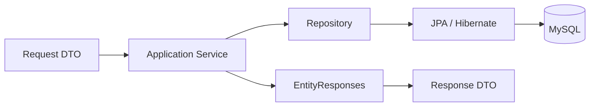

# MASTER APPLICATION SERVICE REPORT

**Đề tài:** “XÂY DỰNG HỆ THỐNG QUẢN LÝ VÀ HỖ TRỢ KỸ THUẬT TRONG DỊCH VỤ SỬA CHỮA THIẾT BỊ APPLE”

Project: `D:\Class\DOAN\CNPM\apple-repair-service\apple-repair-service`  
Ngày xác minh: **12/09/2026**, múi giờ UTC+07:00.  
Phạm vi: hoàn tất **MASTER APPLICATION SERVICE PHASE** trên source đang có.

## A. RESUME STATUS

Khi tiếp tục, 8 group đã được triển khai: foundation/master data/customer; appointment; ticket/inspection/history; technician; inventory; payment/warranty/feedback; ML persistence. Checkpoint trước khi dừng đã chạy thành công 59 unit/business test và 15 integration test MySQL. Baseline ApplicationContext đã chạy lại thành công sau khi MySQL 3307 hoạt động trở lại.

Phần còn thiếu là cleanup cuối, full clean test, chứng minh cleanup dữ liệu, package không skip test, khởi động executable JAR, audit schema cuối và báo cáo. Đã đọc source main/test, POM, YAML, báo cáo data model và log checkpoint; không reset, restore hay triển khai lại các group.

Source lúc resume có 194 file main Java: 79 DTO, 26 `@Service`, 8 helper/policy trong package service, 7 exception, 1 mapper, 1 config, cùng baseline 26 entity, 19 enum, 26 repository và bootstrap. Có 11 file test/support, 10 test class, **76 `@Test`**. Test discount precision đã được thêm trước khi dừng nhưng chưa có trong checkpoint 59 unit/business test.

Thay đổi sau resume:

- Sửa `ServiceTicketService.recordInspection`: khi thay phương án hoặc thay snapshot cùng catalog, giữ item cũ `REJECTED` và tạo item mới; không ghi đè lịch sử giá. Chỉ reuse item khi không cần approval và toàn bộ snapshot không đổi; so tiền bằng giá trị số, không phân biệt scale `100`/`100.00`.
- Thêm 2 regression test: báo giá mới cùng catalog giữ snapshot cũ và chỉ tính tiền item được duyệt; phương án không đổi reuse item.
- Dọn import thừa/wildcard trong 118 file mới của phase, bỏ 4 dependency test không dùng và một validation trùng sau bước kiểm tra history trước khi sort. Format lại 132 file mới main/test bằng formatter có sẵn, không đổi style của entity/enum/baseline.
- Giữ nguyên `DomainAccess.flush()` trước refresh/lock và thiết kế `RetryingWrites`/`WriteTransaction`; giữ validation discount tối đa hai chữ số thập phân và validation history trước sort.

Kết quả cuối: **62 unit/business + 15 integration MySQL + 1 ApplicationContext = 78 test**. So với checkpoint 59 business test: thêm 1 test precision có sẵn lúc resume và 2 regression test mới. Không bỏ, ignore, disable hoặc chuyển integration sang mock để đạt kết quả.

## B. ARCHITECTURE



| Thành phần | Trách nhiệm |
|---|---|
| Request DTO | Java record, dữ liệu đầu vào có Bean Validation; quan hệ được truyền bằng ID. |
| Response DTO | Dữ liệu phẳng hoặc DTO lồng nhau cho detail; không chứa JPA entity, proxy hay password hash. |
| Mapper | `EntityResponses` chuyển trường entity/FK ID sang DTO; không truy vấn DB, không quyết định nghiệp vụ. |
| Service | Validation nghiệp vụ, workflow, transaction/locking, mapping trong transaction; trả DTO hoặc scalar. |
| Repository | Query Spring Data, JPQL và pessimistic lock; không điều phối workflow. |
| Entity | 26 mapping baseline, relationships/constraints và giá trị mặc định; không `@Data`. |
| Exception | Runtime exception mô tả lỗi nghiệp vụ/conflict/not-found; rollback tự động khi thoát transaction. |

Main beans dùng constructor injection với dependency `final` và `@RequiredArgsConstructor`. `CustomerIdentity` và `ServiceStatusService` là service nội bộ với method package-private và propagation `MANDATORY`, không phải giao diện trả entity cho tầng API. Helper `DomainAccess` cung cấp load/lock trong transaction của use case. `TimeConfig` cung cấp `Clock`; test dùng clock cố định để quyết định thời gian không phụ thuộc giờ chạy.

## C. FILE INVENTORY

Đường dẫn Java gốc: `src/main/java/com/applecare/apple_repair_service/`. So với 73 source baseline đã lưu ở data-model audit: **132 file Java mới trong toàn phase, 4 file repository sửa, 69 file baseline nguyên hash**. 132 file mới gồm 122 main và 10 test/support. Đây là số của toàn phase, không phải tất cả được tạo trong lần resume này.

### Request DTO — 45

- [AppointmentDeviceRequest.java](src/main/java/com/applecare/apple_repair_service/dto/request/AppointmentDeviceRequest.java)
- [AppointmentServiceItemRequest.java](src/main/java/com/applecare/apple_repair_service/dto/request/AppointmentServiceItemRequest.java)
- [ApprovalDecisionRequest.java](src/main/java/com/applecare/apple_repair_service/dto/request/ApprovalDecisionRequest.java)
- [AssignTechnicianRequest.java](src/main/java/com/applecare/apple_repair_service/dto/request/AssignTechnicianRequest.java)
- [CancelAppointmentRequest.java](src/main/java/com/applecare/apple_repair_service/dto/request/CancelAppointmentRequest.java)
- [ConfirmAppointmentRequest.java](src/main/java/com/applecare/apple_repair_service/dto/request/ConfirmAppointmentRequest.java)
- [CreateAppointmentRequest.java](src/main/java/com/applecare/apple_repair_service/dto/request/CreateAppointmentRequest.java)
- [CreateBranchRequest.java](src/main/java/com/applecare/apple_repair_service/dto/request/CreateBranchRequest.java)
- [CreateDeviceModelRequest.java](src/main/java/com/applecare/apple_repair_service/dto/request/CreateDeviceModelRequest.java)
- [CreateDeviceTypeRequest.java](src/main/java/com/applecare/apple_repair_service/dto/request/CreateDeviceTypeRequest.java)
- [CreateMlPredictionRequest.java](src/main/java/com/applecare/apple_repair_service/dto/request/CreateMlPredictionRequest.java)
- [CreatePartRequest.java](src/main/java/com/applecare/apple_repair_service/dto/request/CreatePartRequest.java)
- [CreateServiceCatalogItemRequest.java](src/main/java/com/applecare/apple_repair_service/dto/request/CreateServiceCatalogItemRequest.java)
- [CreateServiceFeedbackRequest.java](src/main/java/com/applecare/apple_repair_service/dto/request/CreateServiceFeedbackRequest.java)
- [CreateServiceIssueRequest.java](src/main/java/com/applecare/apple_repair_service/dto/request/CreateServiceIssueRequest.java)
- [CreateServiceTypeRequest.java](src/main/java/com/applecare/apple_repair_service/dto/request/CreateServiceTypeRequest.java)
- [CreateTechnicianScheduleRequest.java](src/main/java/com/applecare/apple_repair_service/dto/request/CreateTechnicianScheduleRequest.java)
- [CreateTransferRequest.java](src/main/java/com/applecare/apple_repair_service/dto/request/CreateTransferRequest.java)
- [CustomerDeviceInfoRequest.java](src/main/java/com/applecare/apple_repair_service/dto/request/CustomerDeviceInfoRequest.java)
- [CustomerInfoRequest.java](src/main/java/com/applecare/apple_repair_service/dto/request/CustomerInfoRequest.java)
- [HandoverRequest.java](src/main/java/com/applecare/apple_repair_service/dto/request/HandoverRequest.java)
- [InspectionRepairItemRequest.java](src/main/java/com/applecare/apple_repair_service/dto/request/InspectionRepairItemRequest.java)
- [IntakeAppointmentDeviceRequest.java](src/main/java/com/applecare/apple_repair_service/dto/request/IntakeAppointmentDeviceRequest.java)
- [RecordInspectionRequest.java](src/main/java/com/applecare/apple_repair_service/dto/request/RecordInspectionRequest.java)
- [RecordPaymentRequest.java](src/main/java/com/applecare/apple_repair_service/dto/request/RecordPaymentRequest.java)
- [RescheduleAppointmentRequest.java](src/main/java/com/applecare/apple_repair_service/dto/request/RescheduleAppointmentRequest.java)
- [ReversePartUsageRequest.java](src/main/java/com/applecare/apple_repair_service/dto/request/ReversePartUsageRequest.java)
- [StockAdjustmentRequest.java](src/main/java/com/applecare/apple_repair_service/dto/request/StockAdjustmentRequest.java)
- [TransferDecisionRequest.java](src/main/java/com/applecare/apple_repair_service/dto/request/TransferDecisionRequest.java)
- [TransferStockRequest.java](src/main/java/com/applecare/apple_repair_service/dto/request/TransferStockRequest.java)
- [UpdateBranchRequest.java](src/main/java/com/applecare/apple_repair_service/dto/request/UpdateBranchRequest.java)
- [UpdateDeviceModelRequest.java](src/main/java/com/applecare/apple_repair_service/dto/request/UpdateDeviceModelRequest.java)
- [UpdateDeviceTypeRequest.java](src/main/java/com/applecare/apple_repair_service/dto/request/UpdateDeviceTypeRequest.java)
- [UpdatePartRequest.java](src/main/java/com/applecare/apple_repair_service/dto/request/UpdatePartRequest.java)
- [UpdateServiceCatalogItemRequest.java](src/main/java/com/applecare/apple_repair_service/dto/request/UpdateServiceCatalogItemRequest.java)
- [UpdateServiceIssueRequest.java](src/main/java/com/applecare/apple_repair_service/dto/request/UpdateServiceIssueRequest.java)
- [UpdateServiceTypeRequest.java](src/main/java/com/applecare/apple_repair_service/dto/request/UpdateServiceTypeRequest.java)
- [UpdateSystemSettingRequest.java](src/main/java/com/applecare/apple_repair_service/dto/request/UpdateSystemSettingRequest.java)
- [UpdateTechnicianScheduleRequest.java](src/main/java/com/applecare/apple_repair_service/dto/request/UpdateTechnicianScheduleRequest.java)
- [UpdateUserProfileRequest.java](src/main/java/com/applecare/apple_repair_service/dto/request/UpdateUserProfileRequest.java)
- [UpdateUserRoleRequest.java](src/main/java/com/applecare/apple_repair_service/dto/request/UpdateUserRoleRequest.java)
- [UpdateUserStatusRequest.java](src/main/java/com/applecare/apple_repair_service/dto/request/UpdateUserStatusRequest.java)
- [UsePartRequest.java](src/main/java/com/applecare/apple_repair_service/dto/request/UsePartRequest.java)
- [WalkInIntakeRequest.java](src/main/java/com/applecare/apple_repair_service/dto/request/WalkInIntakeRequest.java)
- [WarrantyDecisionRequest.java](src/main/java/com/applecare/apple_repair_service/dto/request/WarrantyDecisionRequest.java)

### Response DTO — 34

- [AppointmentDetailResponse.java](src/main/java/com/applecare/apple_repair_service/dto/response/AppointmentDetailResponse.java)
- [AppointmentDeviceDetailResponse.java](src/main/java/com/applecare/apple_repair_service/dto/response/AppointmentDeviceDetailResponse.java)
- [AppointmentDeviceResponse.java](src/main/java/com/applecare/apple_repair_service/dto/response/AppointmentDeviceResponse.java)
- [AppointmentResponse.java](src/main/java/com/applecare/apple_repair_service/dto/response/AppointmentResponse.java)
- [AppointmentServiceItemResponse.java](src/main/java/com/applecare/apple_repair_service/dto/response/AppointmentServiceItemResponse.java)
- [AppointmentSlotResponse.java](src/main/java/com/applecare/apple_repair_service/dto/response/AppointmentSlotResponse.java)
- [AppointmentSummaryResponse.java](src/main/java/com/applecare/apple_repair_service/dto/response/AppointmentSummaryResponse.java)
- [AssignmentResponse.java](src/main/java/com/applecare/apple_repair_service/dto/response/AssignmentResponse.java)
- [BranchInventoryResponse.java](src/main/java/com/applecare/apple_repair_service/dto/response/BranchInventoryResponse.java)
- [BranchResponse.java](src/main/java/com/applecare/apple_repair_service/dto/response/BranchResponse.java)
- [CustomerDeviceResponse.java](src/main/java/com/applecare/apple_repair_service/dto/response/CustomerDeviceResponse.java)
- [CustomerResponse.java](src/main/java/com/applecare/apple_repair_service/dto/response/CustomerResponse.java)
- [DeviceModelResponse.java](src/main/java/com/applecare/apple_repair_service/dto/response/DeviceModelResponse.java)
- [DeviceTypeResponse.java](src/main/java/com/applecare/apple_repair_service/dto/response/DeviceTypeResponse.java)
- [InventoryTransactionResponse.java](src/main/java/com/applecare/apple_repair_service/dto/response/InventoryTransactionResponse.java)
- [MlPredictionResponse.java](src/main/java/com/applecare/apple_repair_service/dto/response/MlPredictionResponse.java)
- [PartResponse.java](src/main/java/com/applecare/apple_repair_service/dto/response/PartResponse.java)
- [PartUsageResponse.java](src/main/java/com/applecare/apple_repair_service/dto/response/PartUsageResponse.java)
- [RepairItemResponse.java](src/main/java/com/applecare/apple_repair_service/dto/response/RepairItemResponse.java)
- [ServiceCatalogItemResponse.java](src/main/java/com/applecare/apple_repair_service/dto/response/ServiceCatalogItemResponse.java)
- [ServiceFeedbackResponse.java](src/main/java/com/applecare/apple_repair_service/dto/response/ServiceFeedbackResponse.java)
- [ServiceIssueResponse.java](src/main/java/com/applecare/apple_repair_service/dto/response/ServiceIssueResponse.java)
- [ServiceStatusHistoryResponse.java](src/main/java/com/applecare/apple_repair_service/dto/response/ServiceStatusHistoryResponse.java)
- [ServiceTicketDetailResponse.java](src/main/java/com/applecare/apple_repair_service/dto/response/ServiceTicketDetailResponse.java)
- [ServiceTicketResponse.java](src/main/java/com/applecare/apple_repair_service/dto/response/ServiceTicketResponse.java)
- [ServiceTicketSummaryResponse.java](src/main/java/com/applecare/apple_repair_service/dto/response/ServiceTicketSummaryResponse.java)
- [ServiceTypeResponse.java](src/main/java/com/applecare/apple_repair_service/dto/response/ServiceTypeResponse.java)
- [SystemSettingResponse.java](src/main/java/com/applecare/apple_repair_service/dto/response/SystemSettingResponse.java)
- [TechnicianRecommendationResponse.java](src/main/java/com/applecare/apple_repair_service/dto/response/TechnicianRecommendationResponse.java)
- [TechnicianScheduleResponse.java](src/main/java/com/applecare/apple_repair_service/dto/response/TechnicianScheduleResponse.java)
- [TicketPaymentSummaryResponse.java](src/main/java/com/applecare/apple_repair_service/dto/response/TicketPaymentSummaryResponse.java)
- [TransferResponse.java](src/main/java/com/applecare/apple_repair_service/dto/response/TransferResponse.java)
- [UserResponse.java](src/main/java/com/applecare/apple_repair_service/dto/response/UserResponse.java)
- [WarrantyEligibilityResponse.java](src/main/java/com/applecare/apple_repair_service/dto/response/WarrantyEligibilityResponse.java)

### Service beans — 26

- [AppointmentService.java](src/main/java/com/applecare/apple_repair_service/service/AppointmentService.java)
- [AssignmentService.java](src/main/java/com/applecare/apple_repair_service/service/AssignmentService.java)
- [BranchService.java](src/main/java/com/applecare/apple_repair_service/service/BranchService.java)
- [CustomerDeviceService.java](src/main/java/com/applecare/apple_repair_service/service/CustomerDeviceService.java)
- [CustomerIdentity.java](src/main/java/com/applecare/apple_repair_service/service/CustomerIdentity.java)
- [CustomerService.java](src/main/java/com/applecare/apple_repair_service/service/CustomerService.java)
- [DeviceModelService.java](src/main/java/com/applecare/apple_repair_service/service/DeviceModelService.java)
- [DeviceTypeService.java](src/main/java/com/applecare/apple_repair_service/service/DeviceTypeService.java)
- [FeedbackService.java](src/main/java/com/applecare/apple_repair_service/service/FeedbackService.java)
- [InventoryService.java](src/main/java/com/applecare/apple_repair_service/service/InventoryService.java)
- [MlPredictionService.java](src/main/java/com/applecare/apple_repair_service/service/MlPredictionService.java)
- [PartService.java](src/main/java/com/applecare/apple_repair_service/service/PartService.java)
- [PaymentService.java](src/main/java/com/applecare/apple_repair_service/service/PaymentService.java)
- [RepairDurationService.java](src/main/java/com/applecare/apple_repair_service/service/RepairDurationService.java)
- [RepairItemService.java](src/main/java/com/applecare/apple_repair_service/service/RepairItemService.java)
- [ServiceCatalogService.java](src/main/java/com/applecare/apple_repair_service/service/ServiceCatalogService.java)
- [ServiceIssueService.java](src/main/java/com/applecare/apple_repair_service/service/ServiceIssueService.java)
- [ServiceStatusService.java](src/main/java/com/applecare/apple_repair_service/service/ServiceStatusService.java)
- [ServiceTicketService.java](src/main/java/com/applecare/apple_repair_service/service/ServiceTicketService.java)
- [ServiceTypeService.java](src/main/java/com/applecare/apple_repair_service/service/ServiceTypeService.java)
- [SystemSettingService.java](src/main/java/com/applecare/apple_repair_service/service/SystemSettingService.java)
- [TechnicianRecommendationService.java](src/main/java/com/applecare/apple_repair_service/service/TechnicianRecommendationService.java)
- [TechnicianScheduleService.java](src/main/java/com/applecare/apple_repair_service/service/TechnicianScheduleService.java)
- [TransferService.java](src/main/java/com/applecare/apple_repair_service/service/TransferService.java)
- [UserService.java](src/main/java/com/applecare/apple_repair_service/service/UserService.java)
- [WarrantyService.java](src/main/java/com/applecare/apple_repair_service/service/WarrantyService.java)

### Exception — 7

- [BusinessException.java](src/main/java/com/applecare/apple_repair_service/exception/BusinessException.java)
- [BusinessRuleViolationException.java](src/main/java/com/applecare/apple_repair_service/exception/BusinessRuleViolationException.java)
- [ConflictException.java](src/main/java/com/applecare/apple_repair_service/exception/ConflictException.java)
- [DuplicateResourceException.java](src/main/java/com/applecare/apple_repair_service/exception/DuplicateResourceException.java)
- [InsufficientStockException.java](src/main/java/com/applecare/apple_repair_service/exception/InsufficientStockException.java)
- [InvalidStateTransitionException.java](src/main/java/com/applecare/apple_repair_service/exception/InvalidStateTransitionException.java)
- [ResourceNotFoundException.java](src/main/java/com/applecare/apple_repair_service/exception/ResourceNotFoundException.java)

### Mapper — 1

- [EntityResponses.java](src/main/java/com/applecare/apple_repair_service/mapper/EntityResponses.java)

### Helper/policy trong package service — 8

- [BusinessRules.java](src/main/java/com/applecare/apple_repair_service/service/BusinessRules.java)
- [DomainAccess.java](src/main/java/com/applecare/apple_repair_service/service/DomainAccess.java)
- [PricePolicy.java](src/main/java/com/applecare/apple_repair_service/service/PricePolicy.java)
- [RetryingWrites.java](src/main/java/com/applecare/apple_repair_service/service/RetryingWrites.java)
- [TechnicianEligibility.java](src/main/java/com/applecare/apple_repair_service/service/TechnicianEligibility.java)
- [TicketCodeGenerator.java](src/main/java/com/applecare/apple_repair_service/service/TicketCodeGenerator.java)
- [WarrantyPolicy.java](src/main/java/com/applecare/apple_repair_service/service/WarrantyPolicy.java)
- [WriteTransaction.java](src/main/java/com/applecare/apple_repair_service/service/WriteTransaction.java)

### Config — 1

- [TimeConfig.java](src/main/java/com/applecare/apple_repair_service/config/TimeConfig.java)

### Repository sửa — 4

- [BranchInventoryRepository.java](src/main/java/com/applecare/apple_repair_service/repository/BranchInventoryRepository.java)
- [MlPredictionRepository.java](src/main/java/com/applecare/apple_repair_service/repository/MlPredictionRepository.java)
- [ServiceTicketRepository.java](src/main/java/com/applecare/apple_repair_service/repository/ServiceTicketRepository.java)
- [TechnicianScheduleRepository.java](src/main/java/com/applecare/apple_repair_service/repository/TechnicianScheduleRepository.java)

### Test/support — 11 file; 10 test class + TestData

- [AppleRepairServiceApplicationTests.java](src/test/java/com/applecare/apple_repair_service/AppleRepairServiceApplicationTests.java)
- [ApplicationTransactionsIntegrationTest.java](src/test/java/com/applecare/apple_repair_service/service/ApplicationTransactionsIntegrationTest.java)
- [AppointmentServiceTest.java](src/test/java/com/applecare/apple_repair_service/service/AppointmentServiceTest.java)
- [ClosureServiceTest.java](src/test/java/com/applecare/apple_repair_service/service/ClosureServiceTest.java)
- [CustomerIdentityTest.java](src/test/java/com/applecare/apple_repair_service/service/CustomerIdentityTest.java)
- [InventoryServiceTest.java](src/test/java/com/applecare/apple_repair_service/service/InventoryServiceTest.java)
- [MasterDataServiceTest.java](src/test/java/com/applecare/apple_repair_service/service/MasterDataServiceTest.java)
- [MlPredictionServiceTest.java](src/test/java/com/applecare/apple_repair_service/service/MlPredictionServiceTest.java)
- [TechnicianServiceTest.java](src/test/java/com/applecare/apple_repair_service/service/TechnicianServiceTest.java)
- [TestData.java](src/test/java/com/applecare/apple_repair_service/service/TestData.java)
- [TicketCoreServiceTest.java](src/test/java/com/applecare/apple_repair_service/service/TicketCoreServiceTest.java)

Manifest đầy đủ cùng SHA-256: [source-inventory.json](docs/application-service/source-inventory.json). Baseline 26 entity và 19 enum không có hash thay đổi; `pom.xml`, `application.yaml` được giữ nguyên. Thư mục `controller` trống có sẵn, không có controller Java mới.

## D. SERVICE INVENTORY

Các dependency dùng chung: `BusinessRules` validation, `DomainAccess` load/lock, `EntityResponses` mapping và `Clock` thời gian. Bảng dưới liệt kê dependency nghiệp vụ/repository riêng; chi tiết transaction theo từng method nằm ở mục F.

| Service | Trách nhiệm | Methods chính | Repository/dependency chính |
|---|---|---|---|
| `AppointmentService` | Booking nhiều thiết bị/hạng mục, snapshot, trạng thái lịch hẹn và expiration. | `createAppointment`, `countActiveBookings`, `getById`, `findByPhone`, `confirmAppointment`, `rescheduleAppointment`, `cancelAppointment`, `expireAppointment`, `markArrived` | `AppointmentRepository`, `AppointmentDeviceRepository`, `AppointmentServiceItemRepository`, `CustomerIdentity`, `SystemSettingService`, `WarrantyPolicy`, `RetryingWrites` |
| `AssignmentService` | Phân công KTV hợp lệ, tối đa một assignment ACTIVE mỗi ticket. | `assignTechnician`, `getHistory` | `ServiceTicketRepository`, `AssignmentRepository`, `TechnicianEligibility`, `ServiceStatusService` |
| `BranchService` | CRUD và kích hoạt/ngừng hoạt động chi nhánh. | `getById`, `list`, `create`, `update`, `activate`, `deactivate` | `BranchRepository` |
| `CustomerDeviceService` | Tìm/tạo thiết bị vật lý theo customer/model/serial; DTO đọc. | `findOrCreateDevice`, `getById`, `listByCustomer` | `CustomerIdentity`, `CustomerDeviceRepository`, `RetryingWrites` |
| `CustomerIdentity` | Resolve customer/device nội bộ dùng chung cho booking/intake. | `resolve [nội bộ]`, `resolveDevice [nội bộ]` | `CustomerRepository`, `CustomerDeviceRepository` |
| `CustomerService` | Reuse customer theo phone; xem customer. | `findOrCreateByPhone`, `getById`, `list` | `CustomerIdentity`, `CustomerRepository`, `RetryingWrites` |
| `DeviceModelService` | CRUD model gắn DeviceType, kiểm tra tên trùng trong phạm vi type. | `getById`, `list`, `create`, `update`, `activate`, `deactivate` | `DeviceModelRepository` |
| `DeviceTypeService` | CRUD loại thiết bị, kiểm tra tên trùng. | `getById`, `list`, `create`, `update`, `activate`, `deactivate` | `DeviceTypeRepository` |
| `FeedbackService` | Feedback boolean duy nhất sau bàn giao. | `createFeedback`, `getByTicket` | `ServiceFeedbackRepository` |
| `InventoryService` | Nhập/xuất kho, dùng/trả linh kiện, chuyển kho và audit. | `stockIn`, `stockOut`, `usePart`, `reversePartUsage`, `transferStock`, `getInventory`, `getTransactionHistory` | `BranchInventoryRepository`, `PartUsageRepository`, `InventoryTransactionRepository` |
| `MlPredictionService` | Validate và append prediction, lấy latest/history. | `savePrediction`, `getLatestPrediction`, `getPredictionHistory` | `MlPredictionRepository` |
| `PartService` | CRUD linh kiện, partCode và giá không âm. | `getById`, `list`, `create`, `update`, `activate`, `deactivate` | `PartRepository` |
| `PaymentService` | Tổng tiền theo item APPROVED, ghi nhận thanh toán/settle zero. | `calculateTicketTotal`, `getSummary`, `recordPayment`, `settleZeroAmountTicket` | `RepairItemRepository` |
| `RepairDurationService` | Tính số phút chỉ trong trạng thái REPAIRING. | `calculateCompletedRepairMinutes`, `calculateCurrentRepairMinutes` | `ServiceStatusHistoryRepository` |
| `RepairItemService` | Đọc hạng mục và ghi quyết định approval. | `listByTicket`, `recordApprovalDecision` | `RepairItemRepository`, `ServiceStatusService` |
| `ServiceCatalogService` | Catalog theo model/type/issue, giá/duration/warranty; REPLACEMENT cần part. | `getById`, `list`, `create`, `update`, `activate`, `deactivate` | `ServiceCatalogItemRepository` |
| `ServiceIssueService` | CRUD triệu chứng/vấn đề dịch vụ. | `getById`, `list`, `create`, `update`, `activate`, `deactivate` | `ServiceIssueRepository` |
| `ServiceStatusService` | State machine tập trung, lịch sử nguyên tử, kết thúc assignment khi phù hợp. | `initialize [nội bộ]`, `changeStatus [nội bộ]` | `ServiceStatusHistoryRepository`, `AssignmentRepository` |
| `ServiceTicketService` | Intake, walk-in, inspection, repair, cancel và handover. | `handover`, `intakeAppointmentDevice`, `createWalkInTicket`, `getById`, `findByPhone`, `startInspection`, `waitForPart`, `resumeRepair`, `cancelTicket`, `recordInspection`, `finishRepair` | `ServiceTicketRepository`, `RepairItemRepository`, `AppointmentServiceItemRepository`, `ServiceStatusHistoryRepository`, `CustomerIdentity`, `ServiceStatusService`, `TicketCodeGenerator`, `WarrantyPolicy`, `RetryingWrites`, `PaymentService` |
| `ServiceTypeService` | CRUD loại dịch vụ với enum code baseline. | `getById`, `list`, `create`, `update`, `activate`, `deactivate` | `ServiceTypeRepository` |
| `SystemSettingService` | Đọc typed setting, kiểm tra giá trị và upsert. | `getString`, `getDecimal`, `getInteger`, `list`, `update` | `SystemSettingRepository` |
| `TechnicianRecommendationService` | Ước lượng workload theo duration và xếp hạng KTV. | `recommend` | `TechnicianScheduleRepository`, `AssignmentRepository`, `MlPredictionRepository`, `RepairItemRepository` |
| `TechnicianScheduleService` | Lịch làm việc, role/status/branch/time, chống overlap. | `create`, `update`, `getById`, `listByTechnicianAndDate` | `TechnicianScheduleRepository`, `TechnicianEligibility` |
| `TransferService` | Request/direct/accept/reject/cancel chuyển KTV. | `requestTransfer`, `directTransfer`, `acceptTransfer`, `rejectTransfer`, `cancelTransfer`, `getHistory` | `TransferRepository`, `AssignmentRepository`, `ServiceTicketRepository`, `TechnicianEligibility` |
| `UserService` | Đọc/cập nhật thông tin, role/status; không đăng nhập hoặc đổi mật khẩu. | `getById`, `list`, `updateProfile`, `updateRole`, `updateStatus` | `UserRepository` |
| `WarrantyService` | Kiểm tra hạn và ghi quyết định warranty return. | `checkEligibility`, `recordWarrantyDecision` | `WarrantyPolicy` |

Helper: `BusinessRules` kiểm tra dữ liệu; `DomainAccess` giữ thay đổi chưa flush rồi refresh với lock; `PricePolicy` giảm giá; `RetryingWrites` phân loại conflict và retry; `WriteTransaction` cung cấp proxy transaction riêng; `TicketCodeGenerator` cấp mã; `TechnicianEligibility` kiểm tra KTV/shift hiện tại; `WarrantyPolicy` kiểm tra eligibility và chuỗi nguồn bảo hành.

## E. BUSINESS RULE IMPLEMENTATION

### 1. Customer

Trim tên/phone, phone là khóa định danh reuse. Có customer thì cập nhật tên theo input hợp lệ; không tạo customer thứ hai cùng phone. UNIQUE conflict khi tạo đồng thời được xử lý bằng rollback attempt rồi retry cả workflow trong transaction mới khi không có outer transaction.

### 2. CustomerDevice

Có serial: kiểm tra thiết bị đã tồn tại, chỉ reuse khi đúng customer và model; serial của customer khác hoặc model khác gây conflict. Không serial: tạo thiết bị vật lý mới, không deduplicate chỉ bằng model. Customer được khóa khi resolve thiết bị.

### 3. Booking

Một appointment có nhiều device, mỗi device nhiều service item; không cho catalog ID trùng trong cùng device. Slot phải OPEN và chưa qua thời điểm bắt đầu; không có capacity hay cột capacity. Catalog ACTIVE, đúng model. Chỉ count booking không CANCELLED/EXPIRED. Snapshot tên/basePrice/finalPrice và discount được lưu tại thời điểm booking; giá chưa biết giữ null. Discount lấy ONLINE_DISCOUNT_PERCENT, chỉ thiếu setting mới fallback 10.00%; range 0..100, tối đa hai chữ số thập phân, tiền HALF_UP hai chữ số. Warranty source nếu có phải đúng customer/model, catalog WARRANTY và đủ điều kiện vào ngày kiểm tra.

### 4. Appointment state

PENDING_CONFIRMATION → CONFIRMED/CANCELLED/EXPIRED; CONFIRMED → ARRIVED/CANCELLED/EXPIRED. ARRIVED/CANCELLED/EXPIRED không quay lại trạng thái trước. Confirm lưu người/thời điểm; reschedule chỉ cho trạng thái còn mở và slot mới hợp lệ. APPOINTMENT_GRACE_MINUTES bắt buộc, integer không âm; expire chỉ khi now > slot start + grace, không expire đúng mốc deadline.

### 5. Intake

Appointment phải ARRIVED. Khóa appointment cha rồi kiểm tra ticket theo AppointmentDevice, bảo vệ intake đồng thời. Mỗi AppointmentDevice tối đa một ticket. Copy snapshot booking thành RepairItem APPROVED và giữ discount online. Walk-in có discount 0, chọn catalog tùy input hợp lệ. Ghi history ban đầu null → WAITING_ASSIGNMENT trong cùng transaction. Mã ticket dạng ST-yyyyMMdd-UUID; có precheck và retry conflict thực tại DB.

### 6. Ticket state

Mọi thay đổi status của ticket trong main service đi qua ServiceStatusService.changeStatus. Initialize chỉ ghi history cho status mặc định WAITING_ASSIGNMENT. Matrix chính xác ở bảng bên dưới; không thêm COMPLETED. Cancel cần reason, ticket chưa PAID và còn ở trạng thái cho phép cancel. Khi chuyển WAITING_HANDOVER hoặc CANCELLED, assignment ACTIVE kết thúc để không tiếp tục chiếm workload.

### 7. Inspection

Chỉ khi INSPECTING. Validate model/catalog/giá/warranty source của phương án thực tế, không trùng catalog trong request. Có customer approval thì tạo phương án PENDING, chuyển WAITING_APPROVAL; không cần thì APPROVED, chuyển REPAIRING. Item bị thay thế giữ lại REJECTED, người/thời điểm/note thay thế; giữ nguyên snapshot cũ. Kể cả catalog ID giống nhưng giá/tên/nguồn bảo hành đổi cũng không ghi đè item cũ. Phương án không đổi và không cần approval có thể reuse item. Tổng tiền loại item REJECTED/PENDING nên không tính trùng.

### 8. Approval

Quyết định phải APPROVED hoặc REJECTED, ticket WAITING_APPROVAL và item còn PENDING. Khóa ticket rồi item; ghi người/thời điểm/note. Còn item PENDING thì tiếp tục chờ. Khi tất cả được quyết định: có item APPROVED → REPAIRING; tất cả REJECTED → WAITING_HANDOVER. History được ghi cùng transaction.

### 9. Repair duration

Đọc history, kiểm tra record/time/status trước sort; sort theo changedAt rồi ID. Kiểm tra from/to liên tục và không lặp status. Cộng interval bắt đầu khi vào REPAIRING, đóng khi ra REPAIRING. WAITING_PART và WAITING_APPROVAL không tính. Completed chỉ tính interval đã đóng; Current cộng interval còn mở tới Clock.now. Không lưu cột duration mới.

### 10. Technician schedule

KTV phải có role TECHNICIAN và status ACTIVE, branch hợp lệ. startTime < endTime; phát hiện overlap lịch cùng KTV/ngày, loại lịch CANCELLED; lịch OFF còn được xét để tránh ghi đè lịch nghỉ. Hai khoảng liền kề được phép. Lock User để serialize create/update; đổi KTV thì khóa các user theo ID tăng dần.

### 11. Assignment

Khóa ticket PESSIMISTIC_WRITE trước khi kiểm tra assignment ACTIVE và trạng thái WAITING_ASSIGNMENT. Lock KTV, kiểm tra role/status, WORKING tại đúng branch và thời gian thực tế [start,end). Tạo assignment ACTIVE và history ASSIGNED nguyên tử. AssignmentSource.TRANSFER dành cho workflow transfer, không đi vòng qua assign thường.

### 12. Recommendation

Ưu tiên latest REPAIR_DURATION có duration > 0, tie-break bằng prediction ID; thiếu ML thì SUM standardDurationMinutes dương của các repair item không REJECTED; thiếu toàn bộ mới dùng DEFAULT_JOB_MINUTES=60. Workload là SUM duration dự kiến của ticket có assignment ACTIVE, distinct ticket, không phải đếm ticket. estimatedAvailableAt=now+workload; eligibility kiểm tra workload+new job nằm trong ca hiện tại. Sort eligible trước, availableAt sớm hơn, workload thấp hơn, technicianId tăng. Không lưu recommendation, không gọi Python.

### 13. Transfer

Request tạo PENDING, chống trùng cặp old assignment/target đang chờ; direct thực hiện ngay. Validate old ACTIVE, target khác và đủ điều kiện ca làm; accept kiểm tra lại điều kiện lúc nhận. Khóa ticket → assignment → transfer trước quyết định. Accept/direct kết thúc old assignment, tạo assignment mới ACTIVE/source TRANSFER, lưu responder/time. Reject/cancel giữ old ACTIVE. Không thay business status của ticket.

### 14. Inventory

Tất cả quantity đầu vào > 0; stock không âm, cộng có kiểm tra integer overflow. Part lock bảo vệ cả trường hợp chưa có BranchInventory; row đã có dùng FOR UPDATE. Stock in/out ghi movement cùng thay đổi stock. usePart cần item APPROVED và ticket REPAIRING/WAITING_PART; giảm kho, tạo ACTIVE PartUsage và USAGE_OUT nguyên tử. Reverse chỉ cho ACTIVE, tăng lại kho, đánh dấu REVERSED và USAGE_RETURN nguyên tử; lần hai conflict. Cho phép trả lại usage cũ khi part/branch đã inactive. Transfer khác branch, đủ stock, khóa branch inventory theo branch ID tăng dần; giảm/tăng và một movement TRANSFER trong cùng transaction. Đọc tồn chưa có row trả quantity=0, không tự insert.

### 15. Payment

calculateTicketTotal chỉ SUM finalPrice khác null của RepairItem APPROVED, scale hai chữ số; không cộng giá PartUsage. Ghi payment chỉ khi WAITING_HANDOVER, chưa PAID và tổng dương; lưu method và paidAt. Tổng 0 dùng settleZeroAmountTicket: PAID, paidAt có giá trị, paymentMethod=null; không fake method. Ghi payment lặp bị từ chối. Không tạo bảng Payment.

### 16. Handover

WAITING_HANDOVER là trạng thái đầu vào. Tổng dương cần PAID; tổng 0 được settle tự động khi chưa PAID. Ghi handedOverBy/At, rồi centralized transition HANDED_OVER và history cùng transaction. Không cho bàn giao ticket tổng dương chưa thanh toán.

### 17. Warranty

Eligibility yêu cầu source APPROVED trên ticket HANDED_OVER, đủ ngày start/end và ngày kiểm tra nằm trong khoảng bao gồm hai đầu. Kiểm tra đúng customer/model, catalog WARRANTY, không self-reference/cycle; chấp nhận liên chi nhánh khi các điều kiện khác đúng. Decision chỉ cho ticket đã inspection, còn WAITING_APPROVAL/REPAIRING và chưa PAID, không quyết định lặp. APPROVED đặt finalPrice=0.00; REJECTED cần reason, giữ giá. Finish repair của warranty return đã APPROVED copy ngày bảo hành gốc, không gia hạn từ ngày sửa lại. Return chưa quyết định không được finish; return bị REJECTED đi theo phương án dịch vụ tính phí thông thường. Không tạo bảng Warranty.

### 18. Feedback

Chỉ ticket HANDED_OVER, lock ticket trước kiểm tra, tối đa một feedback/ticket cùng UNIQUE constraint baseline. Satisfaction là boolean, không dùng rating sao. Lưu comment/thời điểm bằng entity/Clock sẵn có.

### 19. ML persistence

REPAIR_DURATION yêu cầu duration dương và không trộn trường satisfaction; CUSTOMER_SATISFACTION yêu cầu boolean satisfaction, không có duration, confidence nếu có trong 0..1. Model name/version bắt buộc, trim/validate. Mỗi save tạo record mới, không overwrite prediction cũ. Latest sắp predictedAt DESC, id DESC để xác định khi cùng timestamp; history đọc theo loại. Không HTTP Python, không huấn luyện model.

| Trạng thái ticket hiện tại | Trạng thái tiếp theo được phép |
|---|---|
| WAITING_ASSIGNMENT | ASSIGNED, CANCELLED |
| ASSIGNED | INSPECTING, CANCELLED |
| INSPECTING | REPAIRING, WAITING_APPROVAL, CANCELLED |
| WAITING_APPROVAL | REPAIRING, WAITING_HANDOVER |
| REPAIRING | WAITING_PART, WAITING_HANDOVER |
| WAITING_PART | REPAIRING |
| WAITING_HANDOVER | HANDED_OVER |
| HANDED_OVER, CANCELLED | Không có |

## F. TRANSACTION DESIGN

Các write method dưới đây dùng `@Transactional(isolation = READ_COMMITTED)` với propagation REQUIRED mặc định. Read method dùng `readOnly=true` ở class hoặc method. Runtime exception thoát khỏi proxy gây rollback; không catch lỗi DB rồi tiếp tục dùng persistence context đã lỗi.

| Service | Read-only methods | Write methods / boundary đặc biệt |
|---|---|---|
| AppointmentService | `countActiveBookings`, `getById`, `findByPhone` | `createAppointment [SUPPORTS → retry]`, `confirmAppointment`, `rescheduleAppointment`, `cancelAppointment`, `expireAppointment`, `markArrived` |
| AssignmentService | `getHistory` | `assignTechnician` |
| BranchService | `getById`, `list` | `create`, `update`, `activate`, `deactivate` |
| CustomerDeviceService | `getById`, `listByCustomer` | `findOrCreateDevice [SUPPORTS → retry]` |
| CustomerIdentity | — | `resolve, resolveDevice [MANDATORY, package-private]` |
| CustomerService | `getById`, `list` | `findOrCreateByPhone [retry wrapper]` |
| DeviceModelService | `getById`, `list` | `create`, `update`, `activate`, `deactivate` |
| DeviceTypeService | `getById`, `list` | `create`, `update`, `activate`, `deactivate` |
| FeedbackService | `getByTicket` | `createFeedback` |
| InventoryService | `getInventory`, `getTransactionHistory` | `stockIn`, `stockOut`, `usePart`, `reversePartUsage`, `transferStock` |
| MlPredictionService | `getLatestPrediction`, `getPredictionHistory` | `savePrediction` |
| PartService | `getById`, `list` | `create`, `update`, `activate`, `deactivate` |
| PaymentService | `calculateTicketTotal`, `getSummary` | `recordPayment`, `settleZeroAmountTicket` |
| RepairDurationService | `calculateCompletedRepairMinutes`, `calculateCurrentRepairMinutes` | Không ghi |
| RepairItemService | `listByTicket` | `recordApprovalDecision` |
| ServiceCatalogService | `getById`, `list` | `create`, `update`, `activate`, `deactivate` |
| ServiceIssueService | `getById`, `list` | `create`, `update`, `activate`, `deactivate` |
| ServiceStatusService | — | `initialize, changeStatus [MANDATORY, package-private]` |
| ServiceTicketService | `getById`, `findByPhone` | `handover`, `intakeAppointmentDevice [SUPPORTS → retry]`, `createWalkInTicket [SUPPORTS → retry]`, `startInspection`, `waitForPart`, `resumeRepair`, `cancelTicket`, `recordInspection`, `finishRepair` |
| ServiceTypeService | `getById`, `list` | `create`, `update`, `activate`, `deactivate` |
| SystemSettingService | `getString`, `getDecimal`, `getInteger`, `list` | `update` |
| TechnicianRecommendationService | `recommend` | Không ghi |
| TechnicianScheduleService | `getById`, `listByTechnicianAndDate` | `create`, `update` |
| TransferService | `getHistory` | `requestTransfer`, `directTransfer`, `acceptTransfer`, `rejectTransfer`, `cancelTransfer` |
| UserService | `getById`, `list` | `updateProfile`, `updateRole`, `updateStatus` |
| WarrantyService | `checkEligibility` | `recordWarrantyDecision` |

`SystemSettingService.getDecimal` có cả overload bắt buộc và overload fallback; `WarrantyService.checkEligibility` có overload theo Clock và theo ngày chỉ định. Các overload đọc kế thừa cùng read-only boundary. Private method được gọi từ write method không cần thêm annotation/self-proxy.

### Retry transaction

`CustomerService.findOrCreateByPhone`, `CustomerDeviceService.findOrCreateDevice`, `AppointmentService.createAppointment`, `ServiceTicketService.intakeAppointmentDevice/createWalkInTicket` gọi `RetryingWrites.execute`. Wrapper SUPPORTS không tự mở transaction khi caller chưa có transaction. `WriteTransaction.execute` là bean/proxy riêng, mở REQUIRED + READ_COMMITTED và bao trọn attempt, gồm customer, device, ticket/appointment, child rows và history.

`RetryingWrites` chụp trạng thái có outer transaction trước khi chạy, tối đa 3 attempt, chỉ retry các UNIQUE constraint đã nhận diện: `uk_customers_phone`, `uk_customer_devices_serial_number`, `uk_service_tickets_ticket_code`. Khi không có outer transaction, exception trở lại wrapper sau khi attempt đã rollback; attempt tiếp theo có transaction/persistence context mới. Khi đã tham gia outer transaction, không retry bên trong transaction bị đánh dấu rollback-only: ném ConflictException cho caller rollback và retry toàn bộ outer operation. Constraint khác hoặc hết 3 attempt cũng throw conflict. Không dùng REQUIRES_NEW để commit child ngoài rollback của caller.

`TicketCodeGenerator` có tối đa 5 precheck trong một lần sinh mã. Precheck không thay UNIQUE constraint: collision thực khi insert ticket được retry bởi boundary toàn intake. Test ép collision thật bằng spy riêng generator; DB/repository/transaction vẫn thật. Exhausted collision không để customer/device/ticket/history dở dang.

### Atomic operations và rollback

| Operation | Đơn vị commit/rollback |
|---|---|
| createAppointment | Resolve customer + appointment + tất cả device/item snapshot. Lỗi warranty giữa flow rollback toàn bộ. |
| Appointment intake / walk-in | Customer/device + ticket + repair items + initial history; conflict/retry bao cả attempt. |
| State / inspection / approval | Item/decision/inspection + ticket status + history; nếu kết thúc work thì assignment end cùng transaction. |
| Assignment | Kiểm tra dưới ticket lock + assignment ACTIVE + status ASSIGNED + history. |
| Transfer | Old assignment end + new ACTIVE + transfer decision; lỗi outer giữ lại assignment cũ và không tạo transfer. |
| usePart | Stock decrement + PartUsage + USAGE_OUT; outer failure phục hồi stock và không còn usage/audit. |
| reversePartUsage | Stock increase + REVERSED + USAGE_RETURN; lock và state guard ngăn double reverse. |
| Stock transfer | Tạo inventory đích nếu thiếu + giảm nguồn + tăng đích + TRANSFER; thiếu hàng rollback cả dòng đích mới. |
| Payment / handover | Payment fields; khi handover gồm zero settlement nếu cần, actor/time, ticket status/history. |
| Warranty | Quyết định và finalPrice cập nhật cùng transaction, không sửa giá sau PAID. |
| Feedback / ML | Validate và insert một record, flush trong boundary; conflict/error rollback. |

### Ghép nhiều use case

`DomainAccess.lock` thực hiện **flush → refresh(PESSIMISTIC_WRITE)**. Flush giữ dirty changes của bước trước trong cùng transaction trước khi refresh entity từ DB; flush không commit. Integration test `composedUseCasesPreserveChangesWithinOneTransaction` chứng minh confirm→arrive và payment→handover cùng outer transaction vẫn giữ đúng status/paymentMethod. Test rollback usePart/transfer chứng minh thay đổi đã flush vẫn rollback khi outer thất bại. Các fix này được giữ nguyên.

## G. CONCURRENCY

| Tình huống | Cơ chế | Bằng chứng |
|---|---|---|
| Hai assignment cùng ticket | Ticket FOR UPDATE trước kiểm tra ACTIVE; KTV được khóa/validate sau đó. | 1 thành công, 1 ConflictException; đúng một ACTIVE, một history ASSIGNED. |
| Hai intake cùng AppointmentDevice | Lock Appointment cha rồi kiểm tra ticket hiện có; UNIQUE baseline làm lớp bảo vệ dữ liệu. | 1 thành công, 1 ConflictException. |
| Hai customer cùng phone | UNIQUE phone tại MySQL + rollback/retry whole attempt. | Hai caller thành công, 1 customer; log có SQL 1062 thật. |
| Hai booking cùng phone | Retry cả customer/appointment/children; không dùng transaction lỗi. | 2 appointment hợp lệ dùng 1 customer, không partial rows. |
| Hai decrement cùng stock | Part lock + BranchInventory FOR UPDATE, kiểm tra stock dưới lock. | 1 thành công, 1 InsufficientStockException; stock 0, không âm. |
| Hai stock-in khi inventory chưa tồn tại | Lock Part trước find/create inventory. | Hai caller thành công, 1 inventory row, quantity cộng đủ 2. |
| Hai reverse cùng usage | Ticket lock rồi usage refresh/lock, state ACTIVE được kiểm tra lại. | 1 thành công, 1 ConflictException; stock chỉ tăng một lần. |
| Transfer inventory | Part lock, inventory của hai branch theo ID tăng dần. | Unit kiểm tra movement/stock và integration rollback khi thiếu hàng; thứ tự lock được kiểm tra source. |

Lock hoạt động ở MySQL transaction, không dùng synchronized, Redis hay distributed lock. Khóa Part serialize cả các branch của cùng part, ưu tiên tính đúng và bảo vệ row chưa tồn tại, có đánh đổi throughput. Tối đa một ACTIVE assignment là invariant của service khi các writer đi qua ticket lock; không bổ sung partial unique index vào schema. Query trực tiếp/bypass service không nằm trong bảo đảm này. Thứ tự branch ID giảm deadlock khi chuyển ngược chiều, không phải chứng minh loại bỏ mọi deadlock của mọi tổ hợp outer workflow. Chưa có stress/load test đa node hoặc retry tự động cho mọi deadlock/lock timeout. Recommendation là ảnh chụp tại thời điểm đọc, không đặt chỗ KTV; assign/accept luôn validate lại.

## H. REPOSITORY CHANGES

Giữ 26 repository. Bổ sung **5 method trong 4 file**; không đổi schema để phục vụ query.

### TechnicianScheduleRepository

```java
List<TechnicianSchedule> findAllByTechnician_IdAndWorkDate(
        Long technicianId, LocalDate workDate);
List<TechnicianSchedule> findAllByBranch_IdAndWorkDateAndStatus(
        Long branchId, LocalDate workDate, TechnicianScheduleStatus status);
```

Method đầu phục vụ overlap/current shift và danh sách lịch theo KTV; method sau lấy ứng viên WORKING theo branch/ngày cho recommendation. Đây là derived query.

### ServiceTicketRepository

```java
@Lock(LockModeType.PESSIMISTIC_WRITE)
@Query("select t from ServiceTicket t where t.id = :id")
Optional<ServiceTicket> findByIdForUpdate(@Param("id") Long id);
```

Khóa ticket trước assignment/transfer, serialize các quyết định trên cùng ticket.

### BranchInventoryRepository

```java
@Lock(LockModeType.PESSIMISTIC_WRITE)
@Query("select i from BranchInventory i where i.branch.id = :branchId and i.part.id = :partId")
Optional<BranchInventory> findByBranchPartForUpdate(
        @Param("branchId") Long branchId, @Param("partId") Long partId);
```

Khóa dòng stock hiện có trước mutation; khi chưa có row, Part lock ở service bảo vệ find/create.

### MlPredictionRepository

```java
Optional<MlPrediction> findFirstByServiceTicket_IdAndPredictionTypeOrderByPredictedAtDescIdDesc(
        Long serviceTicketId, PredictionType predictionType);
```

Lấy latest prediction theo loại với tie-break ID deterministic. Query history baseline vẫn được dùng và sort lại theo timestamp/ID cho response. Những query cũ không bị xóa hoặc đổi contract.

## I. TEST REPORT

**MySQL thật tại localhost:3307/apple_repair_service**, server báo phiên bản 8.4.11. Không dùng H2, không đổi profile để né integration, không skip/ignore/disable test. Integration dùng Spring beans/repository/EntityManager/transaction manager thật; chỉ spy `TicketCodeGenerator` để điều khiển collision trong hai test. `open-in-view=false` và `ddl-auto=validate` trong annotation integration. Fixture Clock cố định; race dùng hai thread, CountDownLatch và timeout, không giả lập bằng Mockito repository.

| Test class | Loại | Test | Fail/Error/Skip | Clean test (s) | Package (s) |
|---|---|---:|---|---:|---:|
| AppleRepairServiceApplicationTests | ApplicationContext + MySQL | 1 | 0/0/0 | 22.910 | 22.334 |
| ApplicationTransactionsIntegrationTest | MySQL integration | 15 | 0/0/0 | 13.488 | 12.644 |
| AppointmentServiceTest | Unit/business | 13 | 0/0/0 | 1.297 | 1.183 |
| ClosureServiceTest | Unit/business | 10 | 0/0/0 | 0.612 | 0.648 |
| CustomerIdentityTest | Unit/business | 4 | 0/0/0 | 0.250 | 0.370 |
| InventoryServiceTest | Unit/business | 6 | 0/0/0 | 0.451 | 0.395 |
| MasterDataServiceTest | Unit/business | 4 | 0/0/0 | 0.540 | 0.553 |
| MlPredictionServiceTest | Unit/business | 4 | 0/0/0 | 0.146 | 0.253 |
| TechnicianServiceTest | Unit/business | 10 | 0/0/0 | 0.437 | 0.486 |
| TicketCoreServiceTest | Unit/business | 11 | 0/0/0 | 0.250 | 0.242 |

Tổng **10 test class / 78 test**, gồm **62 unit/business + 15 integration + 1 context**. Cả clean test và clean package: **failures=0, errors=0, skipped=0**. Maven tổng thời gian lần clean test **01:09 min**, lần clean package **01:09 min**; thời gian từng suite được giữ trong JSON kết quả. Đây là duration Maven in log, không cộng nhầm với thời gian chờ tool/IDE.

### Scenarios đã chạy

**AppleRepairServiceApplicationTests (1)**

- `contextLoads`

**ApplicationTransactionsIntegrationTest (15)**

- `simultaneousDecrementsCannotOversell`
- `concurrentBookingsReuseOneCustomerWithoutPartialRows`
- `composedUseCasesPreserveChangesWithinOneTransaction`
- `concurrentInitialStockCreationCreatesOneInventoryRow`
- `failedBookingRollsBackCustomerAndAllChildRows`
- `insufficientStockTransferRollsBackDestinationCreation`
- `concurrentCustomerPhoneResolvesWinnerInFreshTransaction`
- `repeatedCollisionExhaustionLeavesNoPartialIntake`
- `transferRollbackKeepsOldAssignmentActive`
- `simultaneousReversalsRestoreStockOnlyOnce`
- `completeBookingToHandoverKeepsDtosUsableOutsideTransaction`
- `concurrentIntakeCreatesOnlyOneTicket`
- `outerFailureRollsBackUsageStockAndAudit`
- `simultaneousAssignmentsCreateExactlyOneActive`
- `actualTicketCodeCollisionRetriesWholeIntake`

**AppointmentServiceTest (13)**

- `expiredWarrantyRejected`
- `validWarrantyBookingKeepsSource`
- `wrongModelRejected`
- `discountCannotBeSilentlyRoundedInSnapshot`
- `expiresStrictlyAfterGrace`
- `pendingCannotArrive`
- `closedSlotRejected`
- `confirmThenArrive`
- `terminalCannotCancel`
- `fallbackPriceAndRounding`
- `unknownPriceRemainsNull`
- `multipleDevicesAndServicesSnapshotDiscount`
- `countExcludesCancelledAndExpired`

**ClosureServiceTest (10)**

- `duplicatePaymentRejected`
- `rejectedWarrantyKeepsPrice`
- `approvedWarrantyZerosPrice`
- `totalOnlyApprovedFinalPricesNotParts`
- `zeroHandoverSettlesAutomatically`
- `paidCanHandover`
- `warrantyInclusiveDatesAndExpired`
- `feedbackRequiresHandoverAndIsUnique`
- `positiveUnpaidCannotHandover`
- `zeroSettlementHasNoFakeMethod`

**CustomerIdentityTest (4)**

- `serialOwnedByAnotherCustomerConflicts`
- `reusesCustomerAndUpdatesName`
- `createsCustomerWithTrimmedPhoneAndName`
- `noSerialCreatesDistinctPhysicalDevices`

**InventoryServiceTest (6)**

- `transferMovesBothAndCreatesOneMovement`
- `usePartCreatesUsageAndAudit`
- `insufficientStockDoesNotMutate`
- `stockOutDecreases`
- `stockInIncreasesAndAudits`
- `reversalRestoresAndCannotRepeat`

**MasterDataServiceTest (4)**

- `partRejectsNegativePriceBeforePersistence`
- `malformedSettingIsBusinessError`
- `duplicateNameIsCaseInsensitiveAndWhitespaceNormalized`
- `replacementRequiresPart`

**MlPredictionServiceTest (4)**

- `satisfactionPredictionRequiresBoolean`
- `durationPredictionRequiresPositiveDuration`
- `predictionsAlwaysAppend`
- `mixedPredictionsRejected`

**TechnicianServiceTest (10)**

- `rejectsMissingShift`
- `directTransferEndsOldAtomically`
- `rejectsDuplicateAssignment`
- `rejectsInactive`
- `assignmentLocksBeforeCheckingAndTransitions`
- `rejectsWrongRole`
- `rejectTransferKeepsOldActive`
- `recommendationUsesMinutesAndLatestPrediction`
- `adjacentSchedulesAllowedButOverlapRejected`
- `requestAcceptTransferEndsOldAndKeepsTicketState`

**TicketCoreServiceTest (11)**

- `revisedQuoteForSameCatalogRetainsHistoricalSnapshotWithoutDoubleCharging`
- `intakeCopiesBookingAndInitialHistory`
- `duplicateIntakeRejected`
- `inspectionWithApprovalWaits`
- `allRejectedSkipsRepair`
- `walkInHasZeroDiscountAndInitialHistory`
- `durationExcludesWaitingAndTracksOpenInterval`
- `unchangedInspectionReusesExistingItem`
- `transitionsCreateHistoryAndRejectInvalid`
- `inspectionWithoutApprovalStartsRepair`
- `approvedDecisionResumesAfterAllResolved`

Test rollback bao gồm booking lỗi giữa flow, usePart lỗi outer, transfer thiếu stock tạo row đích dở, chuyển KTV lỗi outer và ticket-code retry cạn. Các race/constraint thực được nêu ở mục G. Flow đầy đủ gọi booking→confirm→arrive→intake→assign→inspect→use part→finish→pay→handover→feedback→ML và truy cập DTO ngoài transaction. Test mới cùng catalog kiểm tra giữ snapshot và tổng tiền sau approval, không chỉ verify method call.

Danh sách và thời gian chính xác: [clean-test-results.json](docs/application-service/clean-test-results.json), [package-test-results.json](docs/application-service/package-test-results.json). Suite không phải chứng minh mọi nhánh đều có automated coverage; ví dụ quy tắc không gia hạn bảo hành gốc và toàn bộ matrix được đối chiếu source, không tuyên bố có riêng một integration test cho từng nhánh.

## J. BUILD / STARTUP

Môi trường xác minh: Java 21 (JDK 21.0.7), Maven 3.9.11, Spring Boot 4.1.1, Hibernate ORM 7.4.5.Final, MySQL 8.4.11. Dependency/POM baseline được giữ nguyên.

| Bước | Kết quả | Thời gian / mốc UTC+07:00 | Bằng chứng |
|---|---|---|---|
| `mvn -DskipTests compile` | BUILD SUCCESS | 3.057 s; 15:36:53 12/09/2026 | [final-compile.log](docs/application-service/final-compile.log) |
| `mvn clean test` | BUILD SUCCESS, 78/0/0/0 | 01:09 min; 15:38:31 | [final-test.log](docs/application-service/final-test.log) |
| `mvn clean package` | BUILD SUCCESS, 78/0/0/0 | 01:09 min; 15:41:12 | [final-package.log](docs/application-service/final-package.log) |
| Executable JAR | Started application, Tomcat, Hikari, JPA | Startup 22.44 s; 15:42:15 | [final-startup.log](docs/application-service/final-startup.log) |
| Hibernate validate | PASS, không mapping error | Cả integration/context và JAR | Log + audit metadata |
| MySQL | Kết nối PASS trên 3307 | Audit cuối 15:43:11 | [final-database-audit.json](docs/application-service/final-database-audit.json) |

Lệnh compile báo classes đã up-to-date; hai lệnh `clean` sau đó đã xóa target và **compile lại đủ 194 main + 11 test source**, nên xác minh cuối không dựa vào class cũ. `78/0/0/0` lần lượt là tests/failures/errors/skipped.

Trong process chạy Maven, đặt biến môi trường `SPRING_JPA_HIBERNATE_DDL_AUTO=validate` để cả context test baseline cũng không chạy schema update. Không sửa YAML, không dùng profile khác và không bỏ test. `application.yaml` vẫn giữ cấu hình baseline `ddl-auto: update`; vì vậy để tái hiện kiểm tra không mutation cần giữ override validate này.

```powershell
$env:SPRING_JPA_HIBERNATE_DDL_AUTO = 'validate'
mvn clean test
mvn clean package
```

Artifact: [target/apple-repair-service-0.0.1-SNAPSHOT.jar](target/apple-repair-service-0.0.1-SNAPSHOT.jar). Đường dẫn tuyệt đối: `D:\Class\DOAN\CNPM\apple-repair-service\apple-repair-service\target\apple-repair-service-0.0.1-SNAPSHOT.jar`.

SHA-256: `245969557D73B710A8DF7F27B461B812B52CA44859A5401E4F33812E003B4B4D`.

Lệnh JAR thực tế dùng executable JDK trực tiếp và đúng shell Windows:

```powershell
& 'C:\Program Files\Java\jdk-21\bin\java.exe' -jar target/apple-repair-service-0.0.1-SNAPSHOT.jar --server.port=0 --spring.jpa.hibernate.ddl-auto=validate
```

Đã launch dưới process ẩn để giữ terminal cho audit, cùng executable/arguments trên. Log xác nhận scan **26 JPA repository interfaces**, Hikari thêm connection MySQL, EntityManagerFactory khởi tạo, Tomcat mở **63587**, application started. Tất cả service beans thuộc component scan khởi tạo trong ApplicationContext; không mapping error, circular dependency, LazyInitializationException hay schema update trong lần startup validate.

PID JAR **13688** được xác thực bằng PID + start time + executable path trước khi dừng tại **15:43:05**. TCP probe trước khi dừng kết nối được cổng 63587. Chỉ dừng process này; MySQL còn chạy và audit DB sau đó thành công. Kết quả: [startup-result.json](docs/application-service/startup-result.json).

## K. DATABASE

`SHOW TABLES` sau package/JAR trả đúng **26 business tables**:

```text
appointment_devices
appointment_service_items
appointment_slots
appointments
assignments
branch_inventories
branches
customer_devices
customers
device_models
device_types
inventory_transactions
ml_predictions
part_usages
parts
repair_items
service_catalog_items
service_feedbacks
service_issues
service_status_histories
service_tickets
service_types
system_settings
technician_schedules
transfers
users
```

Metadata cuối: **219 cột, 50 foreign key, 87 index** (gồm 26 primary, 17 unique không phải primary và 44 index khác). So sánh từng column type/null/default/extra/collation, foreign-key source/target/update/delete rule và index name/columns/uniqueness với [schema-audit.json baseline](docs/master-data-model/schema-audit.json): **0 khác biệt**. 106 dòng index-part trong snapshot đầu resume tương ứng 87 index vì index ghép có nhiều cột. MySQL native ENUM và Java @Enumerated(STRING) giữ nguyên.

### Cleanup test data

Baseline trước final test: **cả 26 bảng đều 0 row**. Sau clean test và sau package/JAR, row count từng bảng khớp baseline, marker APPTEST đều 0 tại branches/customers/users/parts/tickets/customer_devices/catalogs. Các bảng con cũng 0 theo full count, không chỉ dựa vào marker ở bảng cha.

Fixture tạo `APPTEST` + UUID riêng mỗi test; cleanup dùng branch ID của fixture, model/part ID và exact name/phone/username prefix của fixture. ServiceType REPAIR đã có được reuse và chỉ loại row do test tạo với tên đúng prefix. JPQL delete đều có điều kiện và theo thứ tự FK; không DELETE toàn bảng, không TRUNCATE/DROP/reset DB, không xóa dữ liệu người dùng thật. Auto-increment counter có thể tăng do insert/rollback; không reset counter để giả cleanup, và counter không phải thay đổi mapping/schema.

Bằng chứng: [final-baseline.json](docs/application-service/final-baseline.json), [post-clean-test-audit.json](docs/application-service/post-clean-test-audit.json), [final-database-audit.json](docs/application-service/final-database-audit.json). Các query audit chỉ SELECT/SHOW. Không có bảng thứ 27, join table mới hay DDL được thêm trong phase.

## L. WARNINGS

| Warning thực tế | Diễn giải / phạm vi |
|---|---|
| Spring Security generated development password | Auto-configuration từ dependency baseline; password đã che trong log bằng chứng. Chưa cấu hình login/security trong phase này. |
| `spring.jpa.open-in-view is enabled by default` | Có ở context baseline và JAR do giữ YAML; integration riêng tắt open-in-view và vẫn pass khi dùng DTO ngoài transaction. |
| Mockito self-attaching / ByteBuddy dynamic agent | Test inline mock maker trên JDK 21; cảnh báo tương thích JDK tương lai, không phải test failure. POM không bị sửa để giấu cảnh báo. |
| JVM class data sharing | Bootstrap classpath được agent append nên CDS chỉ hỗ trợ boot loader class; test vẫn pass. |
| Hibernate SQL 1062 / SQLState 23000 | UNIQUE conflict cố ý trong race customer/booking và ticket-code collision. Attempt rollback/retry được kiểm tra; đây không phải failed Maven test. |

Không ghi warning thành failure. Log có DEBUG/condition-evaluation output của môi trường chạy; đây là thông tin chẩn đoán, không phải service/controller mới. Lần baseline ngày 11/09 từng thất bại vì endpoint 3307 đóng; sau khi endpoint hoạt động trở lại đã pass. Lần final 12/09 không có lỗi kết nối. Không đổi sang 3306, không sao chép datasource password hoặc generated security password vào báo cáo.

## M. DECISIONS

- Giữ baseline 26 entity/table, 19 enum, MySQL ENUM; datasource localhost:3307.
- ONLINE_DISCOUNT_PERCENT lấy setting, fallback 10.00% duy nhất ở PricePolicy khi setting thiếu; từ chối precision vượt hai chữ số.
- APPOINTMENT_GRACE_MINUTES là setting bắt buộc; không hard-code grace fallback.
- Inspection giữ item bị thay thế REJECTED, tạo phương án mới và bảo toàn snapshot; tổng chỉ tính APPROVED.
- Ticket transition tập trung và history nguyên tử; không thêm COMPLETED.
- Repair duration chỉ tính REPAIRING, loại thời gian chờ.
- Ticket pessimistic lock bảo vệ assignment; lock appointment cha bảo vệ intake.
- Part lock bảo vệ stock row chưa tồn tại, row tồn tại vẫn FOR UPDATE.
- Chuyển kho khóa branch inventory theo branch ID tăng dần.
- Zero-cost ticket settle PAID với paymentMethod null; không fake payment method.
- Warranty return được duyệt không tự kéo dài thời hạn bảo hành nguồn.
- Retry cả attempt trong transaction mới khi không có outer transaction; nếu có outer thì throw để rollback/retry toàn outer.
- Giữ flush trước refresh trong DomainAccess để compose confirm→arrive và payment→handover.
- Integration dùng MySQL thật, open-in-view=false; final Maven/JAR dùng validate mà không sửa YAML.
- Không bắt đầu Controller/API/Security sau khi hoàn tất báo cáo.

## N. DEFERRED

Cố ý chưa triển khai: Controller, REST API, `@RestControllerAdvice`, SecurityConfig, JWT, Login, Authorization, Frontend, Python ML API, model training, Redis, Kafka và Flyway. Spring Boot có các bean framework tự cấu hình từ dependency baseline; không coi đó là API nghiệp vụ do phase tạo. Phân quyền actor ở tầng gọi sẽ thuộc phase sau, hiện service kiểm tra tồn tại user và role/status KTV ở use case tương ứng.

## O. FINAL SCOPE CHECK

| Kiểm tra | Kết quả |
|---|---|
| Entity | 26, toàn bộ hash khớp baseline; không entity thứ 27. |
| Table | Đúng 26, metadata khớp; không table thứ 27/join table mới. |
| Enum/status | 19 enum nguyên hash; không thêm status. |
| Model ngoài scope | Không Payment/Warranty table; không Supplier, PurchaseOrder, TechnicianSkill, RepairItemStatus. |
| DTO | 45 request + 34 response, không JPA entity/passwordHash/Map<String,Object>. |
| Injection | Constructor injection ở main; @Autowired fields chỉ phục vụ Spring integration test. |
| Mapper | Không DB query hay business decision. |
| Ticket status / inventory mutation | Centralized ServiceStatusService / InventoryService; test fixture có set trực tiếp để bố trí dữ liệu, không phải production flow. |
| Money | BigDecimal/validation, không dùng double cho tiền. |
| Password | Không thêm xử lý password/plaintext password vào service hoặc DTO; datasource config baseline được giữ và không in giá trị ra báo cáo. Fixture dùng chuỗi hash giả không đăng nhập được. |
| POM / YAML | Không sửa dependency hoặc endpoint, không thêm profile/schema migration. |
| Test/build | 78 test pass hai lượt final, không skip; clean compile/package/JAR validate pass. |
| Dữ liệu | Cleanup khớp baseline toàn 26 bảng; không reset/drop/truncate. |

## P. FINAL VERDICT

**MASTER APPLICATION SERVICE PHASE COMPLETED**

Full clean test PASS; package PASS; executable JAR startup PASS; Hibernate validate PASS; MySQL 3307 PASS; schema đúng 26 bảng và không thay đổi; test cleanup PASS; không vượt phạm vi phase. Báo cáo và bằng chứng được lưu trong project. **Dừng tại đây; chưa bắt đầu Controller/API/Security.**

