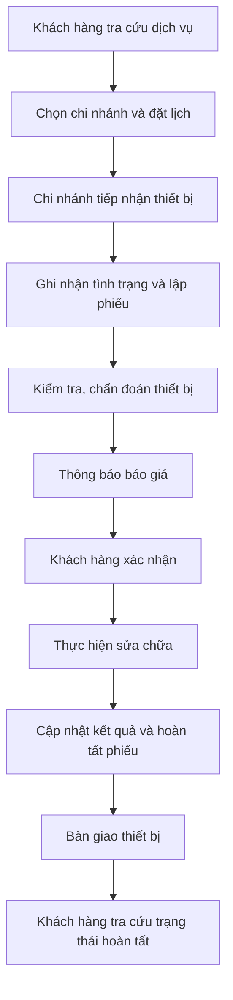
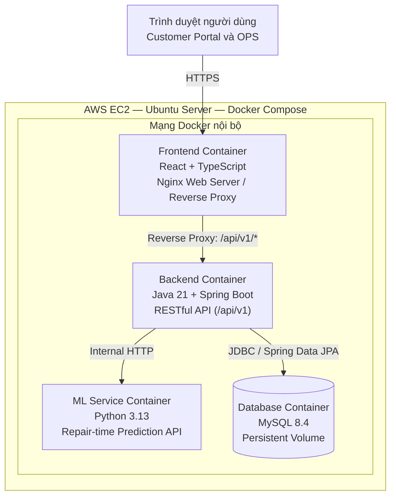
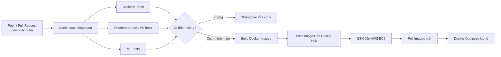

# Táo Care — Apple Repair & Service Management System

**Nền tảng quản lý vận hành trung tâm sửa chữa và bảo hành thiết bị Apple đa chi nhánh, tích hợp dịch vụ Machine Learning hỗ trợ ước tính thời gian sửa chữa.**

<p align="center">
  <a href="https://taocare.ddns.net"><strong>Truy cập hệ thống Production</strong></a>
</p>

Táo Care được xây dựng nhằm số hóa quy trình dịch vụ từ đặt lịch, tiếp nhận thiết bị, điều phối sửa chữa đến cập nhật tiến độ và bàn giao. Hệ thống kết hợp cổng thông tin dành cho khách hàng, không gian vận hành nội bộ (OPS), cơ sở dữ liệu tập trung và một dịch vụ Machine Learning được triển khai tách biệt.

> **Phạm vi tài liệu:** README này mô tả kiến trúc, nghiệp vụ, công nghệ và cách cài đặt theo cấu trúc dự án được cung cấp. Các phiên bản có ký hiệu `+` hoặc mô tả theo major version là phiên bản nền; phiên bản chính xác cần đối chiếu với `pom.xml`, `package-lock.json`, `requirements.txt`, Dockerfile và cấu hình triển khai tương ứng.

---

## Mục lục

- [1. Tổng quan dự án](#1-tổng-quan-dự-án)
- [2. Nghiệp vụ và đối tượng sử dụng](#2-nghiệp-vụ-và-đối-tượng-sử-dụng)
- [3. Kiến trúc hệ thống](#3-kiến-trúc-hệ-thống)
- [4. Công nghệ và thành phần](#4-công-nghệ-và-thành-phần)
- [5. Các phân hệ chức năng](#5-các-phân-hệ-chức-năng)
- [6. Cấu trúc thư mục](#6-cấu-trúc-thư-mục)
- [7. Cài đặt và khởi chạy](#7-cài-đặt-và-khởi-chạy)
- [8. CI/CD và triển khai Production](#8-cicd-và-triển-khai-production)
- [9. Bảo mật, dữ liệu và vận hành](#9-bảo-mật-dữ-liệu-và-vận-hành)
- [10. Kiểm thử và chất lượng phần mềm](#10-kiểm-thử-và-chất-lượng-phần-mềm)
- [11. Tác giả](#11-tác-giả)

---

## 1. Tổng quan dự án

### 1.1. Giới thiệu

**Táo Care** (`apple-repair-service`) là hệ thống quản lý hoạt động của trung tâm sửa chữa và bảo hành các thiết bị thuộc hệ sinh thái Apple, bao gồm iPhone, iPad, MacBook, Apple Watch và AirPods. Hệ thống hướng đến mô hình vận hành nhiều chi nhánh, trong đó dữ liệu dịch vụ, thông tin khách hàng, phiếu sửa chữa, nhân sự và tồn kho linh kiện được quản lý tập trung theo phạm vi nghiệp vụ.

Thay vì quản lý rời rạc qua nhiều công cụ, Táo Care cung cấp một quy trình thống nhất để khách hàng tiếp cận dịch vụ và để nhân viên theo dõi, xử lý các yêu cầu sửa chữa trong suốt vòng đời của thiết bị.

### 1.2. Mục tiêu

- **Chuẩn hóa quy trình dịch vụ:** Quản lý xuyên suốt các bước đặt lịch, tiếp nhận, chẩn đoán, xác nhận báo giá, sửa chữa và bàn giao.
- **Tập trung dữ liệu đa chi nhánh:** Quản lý thông tin chi nhánh, nhân sự, lịch làm việc, dịch vụ và linh kiện trên cùng một hệ thống.
- **Nâng cao khả năng theo dõi:** Cho phép khách hàng tra cứu tiến độ; hỗ trợ nhân viên kiểm soát trạng thái và trách nhiệm xử lý của từng phiếu.
- **Kiểm soát nguồn lực vận hành:** Theo dõi tồn kho linh kiện theo chi nhánh, việc sử dụng linh kiện và lịch làm việc của nhân sự.
- **Hỗ trợ ra quyết định bằng dữ liệu:** Tích hợp dịch vụ Machine Learning nhằm ước tính thời gian sửa chữa dự kiến từ dữ liệu nghiệp vụ phù hợp.
- **Tách biệt các thành phần kỹ thuật:** Phân chia giao diện, nghiệp vụ lõi, dịch vụ ML và cơ sở dữ liệu thành các thành phần triển khai độc lập.

### 1.3. Nguyên tắc thiết kế

| Nguyên tắc | Định hướng triển khai |
|---|---|
| Quản lý theo vòng đời phiếu | Thông tin tiếp nhận và quá trình sửa chữa được tổ chức theo từng phiếu, có trạng thái xử lý rõ ràng. |
| Phân quyền theo vai trò | Áp dụng Role-Based Access Control (RBAC) để giới hạn chức năng và phạm vi dữ liệu theo nhóm người dùng. |
| Phân tách trách nhiệm | Backend đảm nhiệm nghiệp vụ lõi; ML Service đảm nhiệm xử lý suy luận; Frontend tập trung vào trải nghiệm người dùng. |
| Quản lý dữ liệu tập trung | MySQL lưu trữ dữ liệu quan hệ; dữ liệu được duy trì bằng cơ chế lưu trữ bền vững của Docker khi triển khai theo cấu hình tương ứng. |
| Nhất quán môi trường | Docker và Docker Compose chuẩn hóa cách đóng gói, kết nối và khởi chạy các dịch vụ. |

### 1.4. Phạm vi Machine Learning

Trong phạm vi định hướng của dự án, Machine Learning được sử dụng để **ước tính thời gian sửa chữa dự kiến cho phiếu sửa chữa thiết bị Apple**. Kết quả dự đoán có vai trò tham khảo và hỗ trợ điều phối công việc; không thay thế việc đánh giá kỹ thuật của kỹ thuật viên và không nên được xem là cam kết tuyệt đối về thời điểm hoàn tất.

Các biến đầu vào, quy trình tiền xử lý, thuật toán cuối cùng và chỉ số đánh giá mô hình cần được xác định dựa trên dữ liệu nghiệp vụ thực tế, phân tích dữ liệu khám phá (EDA) và kết quả thực nghiệm. README không cố định trước danh sách đặc trưng hoặc khẳng định một mô hình đã đạt chất lượng triển khai khi chưa có kết quả đánh giá tương ứng.

---

## 2. Nghiệp vụ và đối tượng sử dụng

### 2.1. Nhóm người dùng

| Nhóm người dùng | Vai trò nghiệp vụ chính |
|---|---|
| **Khách hàng (Customer)** | Tra cứu thiết bị và dịch vụ, tham khảo bảng giá, đặt lịch tại chi nhánh và theo dõi tiến độ sửa chữa. |
| **Quản trị viên (Admin)** | Quản trị cấu hình và dữ liệu toàn hệ thống; quản lý các chức năng có phạm vi quản trị trung tâm. |
| **Quản lý chi nhánh (Branch Manager)** | Theo dõi hoạt động của chi nhánh, nhân sự, lịch làm việc và tình hình xử lý phiếu trong phạm vi được phân quyền. |
| **Kỹ thuật viên (Technician)** | Tiếp nhận công việc được phân công, cập nhật tình trạng xử lý và thông tin linh kiện sử dụng trong quá trình sửa chữa. |
| **Lễ tân (Receptionist)** | Hỗ trợ khách hàng, quản lý lịch hẹn và ghi nhận thông tin khi tiếp nhận thiết bị. |

Bảng trên mô tả trách nhiệm ở cấp độ nghiệp vụ. Quyền truy cập cụ thể đối với từng màn hình, thao tác và dữ liệu được xác định bởi cấu hình phân quyền trong Backend.

### 2.2. Quy trình dịch vụ tổng quát



Quy trình trên thể hiện luồng nghiệp vụ ở mức tổng quan. Trạng thái cụ thể và điều kiện chuyển trạng thái cần tuân theo quy tắc được triển khai trong Backend.

### 2.3. Vòng đời trạng thái phiếu sửa chữa

Theo luồng trạng thái được mô tả trong hệ thống, phiếu sửa chữa được theo dõi qua các giai đoạn:

`Tiếp nhận` → `Đang chẩn đoán` → `Chờ xác nhận báo giá` → `Đang sửa chữa` → `Hoàn tất bàn giao`

Việc cập nhật trạng thái cần gắn với thao tác nghiệp vụ tương ứng và được phản ánh nhất quán giữa không gian OPS và chức năng tra cứu dành cho khách hàng.

---

## 3. Kiến trúc hệ thống

### 3.1. Mô hình kiến trúc

Táo Care sử dụng mô hình **kiến trúc đa dịch vụ được đóng gói bằng container (Multi-Service Containerized Architecture)**. Theo cấu hình triển khai được mô tả, hệ thống gồm bốn dịch vụ chính: Frontend, Backend, Machine Learning Service và Database.



Trong mô hình này, Nginx nằm trong Frontend Container và đảm nhiệm việc phân phối tài nguyên giao diện cũng như chuyển tiếp yêu cầu API. Backend, ML Service và Database giao tiếp qua mạng Docker nội bộ theo cấu hình Compose. Việc công khai cổng của từng container cần được kiểm soát trong cấu hình triển khai; không nên mở trực tiếp các cổng nội bộ ra Internet khi không có nhu cầu vận hành tương ứng.

### 3.2. Trách nhiệm của các thành phần

| Thành phần | Công nghệ chính | Trách nhiệm |
|---|---|---|
| **Frontend** | React, TypeScript, Vite, Nginx | Cung cấp giao diện Customer Portal và OPS; gửi yêu cầu đến Backend thông qua API được định tuyến bởi Nginx. |
| **Backend** | Java 21, Spring Boot, Spring Security, Spring Data JPA | Xử lý nghiệp vụ, xác thực, phân quyền, kiểm tra dữ liệu đầu vào và điều phối việc truy cập dữ liệu hoặc gọi ML Service. |
| **ML Service** | Python 3.13, XGBoost, Scikit-learn, Uvicorn | Tiếp nhận yêu cầu suy luận và cung cấp kết quả ước tính thời gian sửa chữa theo mô hình được cấu hình. |
| **Database** | MySQL 8.4 | Lưu trữ dữ liệu quan hệ của hệ thống theo cấu trúc được định nghĩa trong `database/schema.sql`. |
| **Infrastructure** | Docker, Docker Compose, AWS EC2 | Đóng gói, kết nối, khởi chạy và vận hành các dịch vụ trên môi trường triển khai. |

### 3.3. Luồng xử lý yêu cầu

1. **Tiếp nhận yêu cầu tại Frontend:** Trình duyệt truy cập hệ thống qua HTTPS. Nginx phân phối các tài nguyên giao diện và chuyển tiếp những yêu cầu thuộc tiền tố `/api/v1/` đến Backend.
2. **Xác thực và xử lý nghiệp vụ tại Backend:** Spring Boot tiếp nhận REST API, xác thực token JWT, kiểm tra quyền truy cập thông qua Spring Security và thực hiện các quy tắc nghiệp vụ.
3. **Truy xuất dữ liệu:** Backend sử dụng JDBC/Spring Data JPA để thao tác với MySQL. Thông tin kết nối được cấu hình thông qua biến môi trường.
4. **Gọi dịch vụ Machine Learning:** Với yêu cầu cần ước tính thời gian sửa chữa, Backend gửi dữ liệu cần thiết đến ML Service qua mạng nội bộ và tiếp nhận kết quả suy luận.
5. **Trả kết quả cho người dùng:** Backend trả dữ liệu phù hợp cho Frontend; giao diện hiển thị theo vai trò và quyền truy cập của người dùng.

### 3.4. Nguyên tắc phân tách dịch vụ

- Frontend không truy cập trực tiếp vào MySQL.
- Các quy tắc nghiệp vụ và kiểm soát quyền truy cập được đặt tại Backend.
- ML Service được tách khỏi tiến trình Backend để độc lập về môi trường Python và thư viện học máy.
- Database sử dụng vùng lưu trữ bền vững (Docker Volume) theo cấu hình triển khai nhằm tránh phụ thuộc vào vòng đời của container.

---

## 4. Công nghệ và thành phần

Bảng dưới đây tổng hợp công nghệ được mô tả trong dự án. Các phiên bản dạng `18+`, `5+` hoặc `3.x` thể hiện dải phiên bản nền, không phải số phiên bản khóa chính xác của từng dependency.

| Phân lớp | Công nghệ / thành phần | Phiên bản hoặc nền tảng | Vai trò trong hệ thống |
|---|---|---|---|
| **Frontend** | React | 18+ | Xây dựng giao diện người dùng theo mô hình component. |
| | TypeScript | 5+ | Bổ sung hệ thống kiểu tĩnh cho mã nguồn Frontend. |
| | Vite | Theo cấu hình dự án | Công cụ phát triển và đóng gói ứng dụng Frontend. |
| | Node.js | 22 LTS | Môi trường chạy các công cụ phát triển, cài đặt dependency và build Frontend. |
| | Nginx | Alpine-based image | Phân phối tài nguyên tĩnh và Reverse Proxy đến Backend API. |
| **Backend** | Java (Eclipse Temurin) | 21 LTS | Nền tảng thực thi dịch vụ nghiệp vụ lõi. |
| | Spring Boot | 3.x | Xây dựng ứng dụng Backend và RESTful API. |
| | Spring Security | Theo Spring Boot dependency configuration | Xác thực và phân quyền, tích hợp cơ chế JWT. |
| | Spring Data JPA | Theo Spring Boot dependency configuration | Hỗ trợ truy cập và ánh xạ dữ liệu quan hệ. |
| | Maven | Theo Maven Wrapper / cấu hình dự án | Quản lý dependency và vòng đời build, test của Backend. |
| **Machine Learning** | Python | 3.13 | Môi trường phát triển và thực thi ML Service. |
| | XGBoost | Theo `requirements.txt` | Thư viện mô hình học máy được sử dụng trong hệ sinh thái ML của dự án. |
| | Scikit-learn | Theo `requirements.txt` | Hỗ trợ các tác vụ học máy và quy trình đánh giá mô hình. |
| | Uvicorn | Theo `requirements.txt` | ASGI server khởi chạy ứng dụng ML qua entry point `app.main:app`. |
| **Database** | MySQL | 8.4 LTS | Hệ quản trị cơ sở dữ liệu quan hệ. |
| **DevOps & Cloud** | Docker Engine | Theo môi trường cài đặt | Đóng gói và thực thi các dịch vụ trong container. |
| | Docker Compose | V2 | Khai báo, kết nối và điều phối nhiều dịch vụ. |
| | GitHub Actions | Theo workflow trong `.github/workflows/` | Tự động hóa kiểm thử, build image và triển khai. |
| | Docker Hub | Theo cấu hình CI/CD | Lưu trữ Docker Image phục vụ quá trình triển khai. |
| | AWS EC2 | Ubuntu Server | Môi trường máy chủ Production. |

**Nguồn xác định phiên bản chính xác:** `backend/pom.xml`, Maven Wrapper (nếu có), `frontend/package.json`, `frontend/package-lock.json`, `ml/requirements.txt`, các Dockerfile và `docker-compose.yml`. Khi tái triển khai, cần ưu tiên các phiên bản được khóa trong những tệp cấu hình này.

---

## 5. Các phân hệ chức năng

### 5.1. Cổng thông tin khách hàng (Customer Portal)

| Chức năng | Mô tả nghiệp vụ |
|---|---|
| **Danh mục thiết bị** | Tổ chức danh mục theo các dòng thiết bị Apple như iPhone, iPad, MacBook, Apple Watch và AirPods. |
| **Bảng giá dịch vụ** | Hiển thị thông tin dịch vụ, chi phí niêm yết và thời hạn bảo hành tương ứng theo dữ liệu hệ thống. |
| **Đặt lịch sửa chữa** | Cho phép khách hàng chọn chi nhánh, lựa chọn khung giờ còn khả dụng và mô tả tình trạng thiết bị. |
| **Tra cứu tiến độ (Ticket Tracking)** | Cung cấp thông tin trạng thái phiếu sửa chữa theo các giai đoạn xử lý được hệ thống công bố. |
| **Thông tin chi nhánh** | Hiển thị địa chỉ, giờ làm việc, số Hotline, kênh tư vấn Zalo và thông tin liên hệ được quản lý tập trung. |

### 5.2. Không gian vận hành nội bộ (Táo Care OPS)

OPS là khu vực nghiệp vụ dành cho nhân sự trung tâm sửa chữa. Các chức năng được tổ chức theo vai trò và phạm vi chi nhánh được phân quyền.

| Phân hệ | Chức năng nghiệp vụ |
|---|---|
| **Dashboard và báo cáo** | Tổng hợp các chỉ số vận hành như doanh thu, số lượng phiếu tiếp nhận, tỷ lệ hoàn thành và hiệu suất xử lý theo phạm vi quản lý. |
| **Tiếp nhận thiết bị (Intake)** | Ghi nhận thông tin khách hàng, thiết bị và tình trạng ngoại quan tại thời điểm tiếp nhận. |
| **Quản lý phiếu sửa chữa (Repair Tickets)** | Theo dõi trạng thái xử lý, kỹ thuật viên phụ trách, thông tin linh kiện sử dụng và tình trạng thanh toán/bàn giao. |
| **Danh mục dịch vụ** | Quản lý danh mục dịch vụ và thông tin bảng giá được sử dụng trên cổng khách hàng. |
| **Kho linh kiện** | Quản lý danh mục linh kiện và theo dõi tồn kho theo từng chi nhánh. |
| **Quản lý chi nhánh** | Thiết lập thông tin chi nhánh, giờ hoạt động và giới hạn lượt đặt lịch theo khung giờ. |
| **Quản lý lịch hẹn** | Theo dõi khung giờ làm việc và khả năng tiếp nhận lịch hẹn của từng chi nhánh. |
| **Nhân sự và ca làm việc** | Quản lý tài khoản nhân viên, chi nhánh công tác và phân bổ lịch làm việc. |
| **Cấu hình thông tin hệ thống** | Quản lý thông tin thương hiệu, Hotline, Zalo, nội dung chân trang và thông tin liên hệ hiển thị trên Customer Portal. |

### 5.3. Dịch vụ Machine Learning

ML Service được triển khai riêng bằng Python và được Backend gọi thông qua giao tiếp HTTP nội bộ. Vai trò chính của dịch vụ trong định hướng hiện tại là hỗ trợ **ước tính thời gian sửa chữa dự kiến** cho các trường hợp phù hợp.

Nguyên tắc sử dụng kết quả ML:

- Dự đoán là thông tin hỗ trợ lập kế hoạch và điều phối, không phải cam kết thời gian hoàn tất.
- Dữ liệu đầu vào phải được ánh xạ thống nhất với dữ liệu nghiệp vụ mà hệ thống lưu trữ.
- Việc lựa chọn đặc trưng và thuật toán cần dựa trên phân tích dữ liệu, thực nghiệm và đánh giá mô hình; không nên cố định chỉ vì một thuật toán có sẵn trong thư viện.
- Khi dữ liệu đầu vào không đầy đủ hoặc nằm ngoài phạm vi dữ liệu huấn luyện, cần có phương án xử lý phù hợp thay vì trình bày kết quả dự đoán như một giá trị chắc chắn.

---

## 6. Cấu trúc thư mục

Cấu trúc dưới đây mô tả các thư mục và tệp chính được nêu trong tài liệu dự án. Các thư mục con khác có thể được bổ sung tùy theo mã nguồn thực tế.

```text
apple-repair-service/
├── .github/
│   └── workflows/                  # Workflow CI/CD: kiểm thử, build và triển khai
│
├── backend/                         # Backend nghiệp vụ — Java 21 / Spring Boot
│   ├── src/
│   │   ├── main/                    # Mã nguồn và tài nguyên ứng dụng
│   │   └── test/                    # Unit Test / Integration Test
│   ├── pom.xml                      # Dependency và cấu hình Maven
│   ├── mvnw                         # Maven Wrapper (nếu được commit)
│   └── Dockerfile                   # Đóng gói Backend Image
│
├── frontend/                        # Giao diện — React / TypeScript / Vite
│   ├── src/
│   │   ├── hooks/                   # Custom React Hooks
│   │   ├── pages/                   # Các trang Customer Portal và OPS
│   │   └── ...
│   ├── package.json                 # Dependency và scripts
│   ├── package-lock.json            # Khóa phiên bản dependency npm
│   └── Dockerfile                   # Multi-stage build: Node.js → Nginx
│
├── ml/                              # Dịch vụ Machine Learning — Python 3.13
│   ├── app/                          # Ứng dụng ML/API (entry point app.main:app)
│   ├── tests/                        # Kiểm thử ML Service
│   ├── requirements.txt             # Dependency Python
│   └── Dockerfile                   # Đóng gói ML Service Image
│
├── database/
│   └── schema.sql                   # Cấu trúc cơ sở dữ liệu MySQL
│
├── deploy/                          # Tài nguyên và script triển khai
├── docker-compose.yml               # Khai báo các dịch vụ và Docker Network/Volume
└── README.md                        # Tài liệu dự án
```

---

## 7. Cài đặt và khởi chạy

### 7.1. Yêu cầu môi trường

**Phương án khuyến nghị — Docker:**

- Git.
- Docker Engine hoặc Docker Desktop.
- Docker Compose V2.

**Phương án phát triển cục bộ (Local Development):**

- Git.
- JDK 21.
- Node.js 22 và npm.
- Python 3.13 và pip.
- MySQL 8.4.

Các phiên bản phải tương thích với cấu hình trong repository. Có thể kiểm tra môi trường bằng các lệnh:

```bash
git --version
docker --version
docker compose version
java -version
node --version
npm --version
python --version
mysql --version
```

### 7.2. Cấu hình biến môi trường

Tạo tệp `.env` tại thư mục gốc dự án, cùng cấp với `docker-compose.yml`. Khai báo các giá trị tương ứng với cấu hình Docker Compose và Backend.

| Biến môi trường | Bắt buộc theo cấu hình được mô tả | Ý nghĩa |
|---|:---:|---|
| `MYSQL_ROOT_PASSWORD` | Có | Mật khẩu tài khoản quản trị MySQL dùng khi khởi tạo Database Container. |
| `MYSQL_DATABASE` | Có | Tên cơ sở dữ liệu được khởi tạo. |
| `SPRING_DATASOURCE_URL` | Có | JDBC URL để Backend kết nối MySQL. Trong mạng Compose, hostname thường là tên service Database, ở đây là `db`. |
| `SPRING_DATASOURCE_USERNAME` | Có | Tài khoản MySQL mà Backend sử dụng. |
| `SPRING_DATASOURCE_PASSWORD` | Có | Mật khẩu kết nối MySQL của Backend. |
| `JWT_SECRET` | Có | Khóa bí mật dùng để ký và xác thực JWT; giá trị cần đủ độ dài và độ ngẫu nhiên theo yêu cầu cấu hình bảo mật. |
| `ML_SERVICE_URL` | Có | Địa chỉ ML Service trên mạng nội bộ; giá trị mô tả là `http://ml:8000`. |

Ví dụ cấu hình tham khảo:

```dotenv
MYSQL_ROOT_PASSWORD=replace_with_a_strong_password
MYSQL_DATABASE=apple_repair_service
SPRING_DATASOURCE_URL=jdbc:mysql://db:3306/apple_repair_service?useSSL=false&allowPublicKeyRetrieval=true&serverTimezone=Asia/Ho_Chi_Minh
SPRING_DATASOURCE_USERNAME=root
SPRING_DATASOURCE_PASSWORD=replace_with_a_strong_password
JWT_SECRET=replace_with_a_random_secret_of_at_least_32_characters
ML_SERVICE_URL=http://ml:8000
```

**Lưu ý bảo mật:**

- Không sử dụng các giá trị minh họa ở trên cho môi trường Production.
- Không đưa `.env`, mật khẩu, JWT secret hoặc thông tin xác thực máy chủ vào Git repository.
- Giá trị biến môi trường phải trùng khớp với tên biến được tham chiếu trong `docker-compose.yml` và cấu hình Backend.
- `db` và `ml` là hostname nội bộ theo tên service được mô tả; nếu tên service trong Compose khác, cần điều chỉnh URL tương ứng.
- Với môi trường Production, nên cấu hình tài khoản Database riêng cho ứng dụng với quyền tối thiểu cần thiết, thay vì sử dụng tài khoản `root`.

### 7.3. Phương án A — Khởi chạy toàn hệ thống bằng Docker Compose

Đây là phương án phù hợp để dựng môi trường tích hợp, do các dịch vụ được khởi chạy theo cấu hình container thống nhất.

**Bước 1. Lấy mã nguồn**

Thay `OWNER/REPOSITORY` bằng địa chỉ repository thực tế:

```bash
git clone https://github.com/OWNER/REPOSITORY.git
cd apple-repair-service
```

**Bước 2. Tạo cấu hình môi trường**

Tạo tệp `.env` ở thư mục gốc và khai báo các biến tại mục [7.2](#72-cấu-hình-biến-môi-trường). Đảm bảo không sử dụng mật khẩu mẫu cho môi trường Production.

**Bước 3. Build và khởi chạy dịch vụ**

```bash
docker compose up -d --build
```

**Bước 4. Kiểm tra trạng thái container**

```bash
docker compose ps
```

Xem log khi cần kiểm tra lỗi khởi động:

```bash
docker compose logs -f --tail=100
```

**Bước 5. Truy cập hệ thống**

| Thành phần | Địa chỉ mặc định |
|---|---|
| Customer Portal và OPS | `http://localhost` |
| Backend API qua Nginx Reverse Proxy | `http://localhost/api/v1/` |
| Frontend Vite Development Server (chỉ dùng ở phương án Local) | `http://localhost:5173` |

Địa chỉ và cổng truy cập thực tế phụ thuộc vào phần `ports` trong `docker-compose.yml` và cấu hình Nginx. Đường dẫn `/api/v1/` là tiền tố API; endpoint cụ thể phụ thuộc vào các controller đã triển khai.

**Dừng các dịch vụ:**

```bash
docker compose down
```

Lệnh trên dừng và xóa các container thuộc Compose project nhưng không yêu cầu xóa named volume. Không thêm tùy chọn `-v` nếu cần giữ lại volume dữ liệu MySQL.

### 7.4. Phương án B — Chạy từng dịch vụ ở môi trường Local

Phương án này phù hợp khi phát triển hoặc gỡ lỗi riêng từng thành phần. Nên mở các terminal riêng cho Database, Backend, ML Service và Frontend.

#### Bước 1. Khởi tạo cơ sở dữ liệu MySQL

Từ thư mục gốc repository:

```bash
mysql -u root -p -e "CREATE DATABASE IF NOT EXISTS apple_repair_service;"
mysql -u root -p apple_repair_service < database/schema.sql
```

Đảm bảo MySQL đang chạy và tài khoản sử dụng có quyền tạo cơ sở dữ liệu cũng như nạp schema.

#### Bước 2. Khởi chạy Backend — Spring Boot

```bash
cd backend
```

Trên Linux/macOS, nếu repository có Maven Wrapper:

```bash
./mvnw spring-boot:run
```

Trên Windows PowerShell:

```powershell
.\mvnw.cmd spring-boot:run
```

Nếu không có Maven Wrapper, có thể sử dụng Maven đã cài đặt:

```bash
mvn spring-boot:run
```

Đảm bảo Backend nhận được các biến cấu hình kết nối MySQL, JWT và ML Service theo cấu hình ứng dụng. Khi chạy tiến trình trực tiếp ngoài Docker, không mặc định rằng Spring Boot tự đọc tệp `.env`; cần cấu hình biến môi trường trong terminal, IDE hoặc cơ chế cấu hình mà dự án đang sử dụng.

#### Bước 3. Khởi chạy ML Service — Python

Từ thư mục gốc repository:

```bash
cd ml
python -m venv .venv
```

Kích hoạt môi trường ảo:

```bash
# Linux / macOS
source .venv/bin/activate
```

```powershell
# Windows PowerShell
.venv\Scripts\Activate.ps1
```

Cài đặt thư viện và khởi chạy ứng dụng:

```bash
pip install -r requirements.txt
uvicorn app.main:app --reload --port 8000
```

Lệnh Uvicorn sử dụng entry point `app.main:app`; vì vậy mã nguồn cần có module `app.main` và đối tượng ứng dụng ASGI tương ứng.

#### Bước 4. Khởi chạy Frontend — React / Vite

Mở terminal mới và thực hiện:

```bash
cd frontend
npm ci
npm run dev
```

Truy cập địa chỉ Development Server do Vite hiển thị, thông thường là:

```text
http://localhost:5173
```

Frontend cần được cấu hình API base URL phù hợp với môi trường Local để gọi đúng Backend.

---

## 8. CI/CD và triển khai Production

### 8.1. Tổng quan quy trình

Dự án sử dụng **GitHub Actions** để tự động hóa các bước kiểm tra mã nguồn, xác minh khả năng build và triển khai phiên bản mới lên AWS EC2.



### 8.2. Continuous Integration (CI)

Theo quy trình được mô tả, CI được kích hoạt khi có sự kiện `push` hoặc `pull_request` vào các nhánh `dev` và `main`. Các bước kiểm tra gồm:

1. Khởi tạo dịch vụ MySQL kiểm thử (`mysql:8.4`) trong môi trường CI.
2. Nạp cấu trúc cơ sở dữ liệu từ `database/schema.sql` để chuẩn bị dữ liệu nền cho các bài kiểm thử cần Database.
3. Chạy kiểm thử Backend bằng Maven.
4. Kiểm tra kiểu dữ liệu TypeScript, quy tắc ESLint và Unit Test của Frontend.
5. Chạy bộ kiểm thử tự động của ML Service bằng Pytest.
6. Xác minh quá trình build Docker Image theo workflow đã cấu hình.

Một thay đổi chỉ nên được xem là đủ điều kiện triển khai khi các job bắt buộc của pipeline hoàn tất thành công.

### 8.3. Continuous Deployment (CD)

Khi thay đổi được hợp nhất vào nhánh `main` và thỏa điều kiện workflow, quy trình triển khai được mô tả như sau:

1. Build Docker Image cho các dịch vụ cần triển khai.
2. Đẩy image lên Docker Hub.
3. Kết nối SSH đến máy chủ AWS EC2.
4. Cập nhật image và khởi chạy lại các dịch vụ bằng Docker Compose.
5. Kiểm tra trạng thái container và log sau triển khai.

Quy trình hiện được mô tả có bước dừng stack bằng `docker compose down` trước khi khởi chạy phiên bản mới. Cách triển khai này có thể gây gián đoạn dịch vụ trong khoảng thời gian cập nhật; không nên mô tả là zero-downtime deployment nếu chưa triển khai cơ chế rolling update hoặc chuyển đổi traffic tương ứng.

### 8.4. Quản lý image và dung lượng máy chủ

Nếu workflow thực tế sử dụng:

```bash
docker system prune -af
```

thì lệnh này dọn dẹp các tài nguyên Docker không còn được sử dụng, bao gồm image không được tham chiếu và build cache. Không thêm `--volumes` nếu không có chủ đích xóa volume. Cần kiểm soát bước dọn dẹp để tránh xóa nhầm tài nguyên đang cần cho các dịch vụ khác trên cùng máy chủ.

Thông tin xác thực Docker Hub, SSH key và các tham số nhạy cảm phục vụ triển khai cần được lưu trong GitHub Actions Secrets hoặc cơ chế quản lý bí mật phù hợp, không ghi trực tiếp trong mã nguồn hay workflow.

---

## 9. Bảo mật, dữ liệu và vận hành

### 9.1. Xác thực và phân quyền

- Backend sử dụng Spring Security kết hợp JWT để xác thực yêu cầu.
- RBAC phân tách quyền theo các nhóm người dùng: Admin, Branch Manager, Technician và Receptionist.
- Backend là thành phần chịu trách nhiệm kiểm tra quyền; việc ẩn hoặc hiện chức năng ở Frontend không thay thế kiểm tra phân quyền phía máy chủ.
- Khóa JWT và thông tin kết nối Database phải được quản lý bằng biến môi trường hoặc hệ thống quản lý bí mật phù hợp.

### 9.2. Kết nối dịch vụ

- Người dùng truy cập hệ thống thông qua lớp Web/Nginx.
- Backend giao tiếp với Database và ML Service thông qua mạng nội bộ Docker theo cấu hình triển khai.
- Chỉ công khai những cổng thực sự cần thiết cho hoạt động của hệ thống.
- Môi trường Production cần sử dụng HTTPS và cấu hình chứng thư TLS hợp lệ cho tên miền triển khai.

### 9.3. Lưu trữ và bảo vệ dữ liệu

MySQL được cấu hình sử dụng Docker Volume để duy trì dữ liệu độc lập với vòng đời container. Cơ chế này giúp dữ liệu không bị xóa chỉ vì container được tạo lại, nhưng **không thay thế cho quy trình sao lưu và khôi phục dữ liệu**.

Đối với môi trường vận hành thực tế, cần thiết lập lịch sao lưu Database, kiểm tra khả năng khôi phục định kỳ và giới hạn quyền truy cập vào tệp sao lưu. Không sử dụng thao tác xóa volume khi cập nhật phiên bản nếu chưa có kế hoạch bảo toàn dữ liệu.

### 9.4. Theo dõi và xử lý sự cố

Một số lệnh Docker hữu ích khi kiểm tra trạng thái triển khai:

```bash
# Liệt kê container thuộc Compose project
docker compose ps

# Theo dõi log của toàn bộ dịch vụ
docker compose logs -f --tail=100

# Kiểm tra cấu hình Compose sau khi nội suy biến môi trường
docker compose config
```

Trạng thái `healthy` chỉ xuất hiện khi container hoặc service được cấu hình health check tương ứng. Nếu chưa khai báo health check, cần đánh giá trạng thái qua `docker compose ps`, log và khả năng phản hồi của ứng dụng thay vì mặc định mọi dịch vụ đều có trạng thái `healthy`.

---

## 10. Kiểm thử và chất lượng phần mềm

Dự án phân chia kiểm thử theo từng thành phần để hỗ trợ phát hiện lỗi ở phạm vi phù hợp.

### 10.1. Backend

Chạy Unit Test và Integration Test được cấu hình trong Maven:

```bash
cd backend
./mvnw test
```

Trên Windows PowerShell, nếu có Maven Wrapper:

```powershell
cd backend
.\mvnw.cmd test
```

Hoặc sử dụng Maven cài đặt trên máy:

```bash
mvn test
```

### 10.2. Frontend

Từ thư mục `frontend`:

```bash
npm ci
npm run typecheck
npm run lint
npm run test:unit
```

Các script `typecheck`, `lint` và `test:unit` cần được khai báo tương ứng trong `frontend/package.json`.

### 10.3. Machine Learning Service

Từ thư mục gốc repository:

```bash
python -m pytest ml/tests
```

Hoặc từ bên trong thư mục `ml`:

```bash
cd ml
python -m pytest tests
```

### 10.4. Nguyên tắc chất lượng

- Kiểm thử các quy tắc nghiệp vụ quan trọng ở Backend, đặc biệt là trạng thái phiếu và phạm vi phân quyền.
- Kiểm tra tính nhất quán dữ liệu giữa các phân hệ có liên quan.
- Duy trì kiểm tra kiểu dữ liệu, lint và unit test ở Frontend.
- Kiểm thử ML Service độc lập với các trường hợp đầu vào hợp lệ, thiếu dữ liệu hoặc ngoài phạm vi xử lý đã xác định.
- Đánh giá mô hình ML bằng dữ liệu kiểm thử tách biệt; không chỉ dựa vào kết quả trên tập huấn luyện.
- Chỉ công bố các chỉ số chất lượng mô hình khi có kết quả thực nghiệm có thể tái lập.

---

## 11. Tác giả

| Thông tin | Chi tiết |
|---|---|
| **Tác giả và phát triển hệ thống** | Lê Phúc |
| **Tên dự án** | Táo Care — Apple Repair & Service Management System |
| **Môi trường Production** | [https://taocare.ddns.net](https://taocare.ddns.net) |

---

*Táo Care — Nền tảng hỗ trợ chuẩn hóa quy trình dịch vụ, quản lý vận hành đa chi nhánh và khai thác dữ liệu trong hoạt động sửa chữa thiết bị Apple.*
