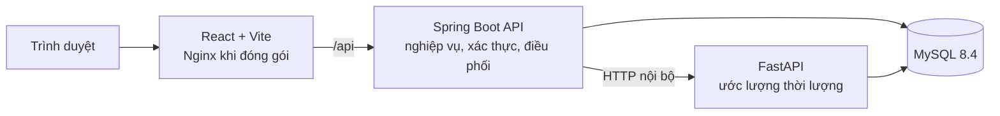

# TáoCare — Apple Repair Service

> Nền tảng quản lý vận hành dịch vụ sửa chữa thiết bị Apple: từ đặt lịch, tiếp nhận, phân công kỹ thuật viên, sửa chữa và sử dụng linh kiện đến thanh toán, bàn giao, bảo hành và báo cáo vận hành.

TáoCare là một hệ thống full-stack cho mô hình trung tâm dịch vụ. Repository này chứa ba thành phần chạy độc lập nhưng phối hợp với nhau: web ứng dụng React, API nghiệp vụ Spring Boot và dịch vụ dự báo thời lượng sửa chữa bằng FastAPI. Thiết kế đặt luồng nghiệp vụ và khả năng truy vết lên trước: trạng thái phiếu, phân công, sử dụng linh kiện, chuyển giao, ước lượng thời gian và thao tác kho đều có dữ liệu nghiệp vụ tương ứng.

## Mục lục

- [Phạm vi đã triển khai](#phạm-vi-đã-triển-khai)
- [Kiến trúc](#kiến-trúc)
- [Công nghệ](#công-nghệ)
- [Luồng vận hành](#luồng-vận-hành)
- [Khởi chạy local](#khởi-chạy-local)
- [Kiểm thử và chất lượng](#kiểm-thử-và-chất-lượng)
- [Triển khai](#triển-khai)
- [Cấu trúc repository](#cấu-trúc-repository)
- [Tài liệu liên quan](#tài-liệu-liên-quan)

## Phạm vi đã triển khai

Hệ thống hiện có các luồng chức năng sau (đối chiếu từ controller, UI và ma trận kiểm thử trong repository):

- **Kênh công khai:** khám phá thiết bị, danh mục dịch vụ, chi nhánh và khung giờ; đặt lịch nhiều thiết bị/dịch vụ; tra cứu lịch hẹn, phiếu và điều kiện bảo hành; gửi đánh giá sau bàn giao.
- **Lễ tân:** xác nhận, đổi lịch, hủy và ghi nhận khách đến; tiếp nhận theo lịch hoặc khách vãng lai; tạo/tra cứu khách và thiết bị; quản lý phiếu, phê duyệt, thanh toán, bàn giao và lịch sử bảo hành.
- **Kỹ thuật viên:** xem công việc được phân công, kiểm tra thiết bị, lập phương án, chờ/xử lý phê duyệt, ghi nhận sử dụng hoặc hoàn linh kiện, trạng thái chờ, chuyển giao và hoàn tất sửa chữa.
- **Quản trị:** quản lý người dùng, chi nhánh, thiết bị, vấn đề, loại dịch vụ, danh mục dịch vụ và linh kiện; lịch làm việc/khung giờ/ngày ngoại lệ; kho, lô nhập, giao dịch, nhập Excel và hàng lỗi; cấu hình hệ thống, thống kê và tổng quan ML.
- **Bảo hành và thời gian:** kiểm tra eligibility, tạo/xử lý yêu cầu bảo hành, liên kết nguồn bảo hành; theo dõi ETA/actual time, lịch sử ước lượng và gián đoạn kỹ thuật.

Phân quyền được thực hiện bằng JWT và Spring Security. Các API `/api/v1/admin/**` yêu cầu vai trò `ADMIN`; các hành động còn lại tiếp tục được kiểm soát theo quyền phương thức và chính sách truy cập nghiệp vụ ở backend.

## Kiến trúc



- **Frontend** là React SPA. Khi phát triển, Vite proxy `/api` tới backend; khi container hóa, Nginx phục vụ static assets và proxy API.
- **Backend** là nơi sở hữu luật nghiệp vụ, phân quyền, trạng thái, dữ liệu và quyết định cuối cùng về phân công/ETA.
- **ML service** trả về dự báo thời lượng kỹ thuật cho từng ứng viên. Nếu ngữ cảnh không phù hợp hoặc ML không khả dụng, backend dùng tổng `standard_duration_minutes` của catalog làm fallback. Dịch vụ ML không tự phân công kỹ thuật viên.
- **Database** dùng MySQL; `database/schema.sql` là schema canonical dành cho database trống. Production chạy `ddl-auto=validate`.

## Công nghệ

| Lớp | Công nghệ thực tế |
| --- | --- |
| Frontend | React 19, TypeScript, Vite 7, React Router 7, TanStack Query, React Hook Form, Zod |
| Backend | Java 21, Spring Boot 4.1, Spring Web MVC, Spring Data JPA, Spring Security, Bean Validation |
| API | REST `/api/v1`, JWT, springdoc OpenAPI/Swagger (mặc định tắt qua cấu hình), DTO và global exception handler |
| Dữ liệu | MySQL 8/8.4, Hibernate/JPA, Apache POI (nhập/xuất Excel) |
| ML | Python, FastAPI, Uvicorn, scikit-learn, CatBoost, pandas, NumPy, joblib, SQLAlchemy/PyMySQL |
| DevOps | Docker Compose, Nginx, GitHub Actions, GHCR/Docker Hub, SSH deployment tới EC2/VPS |
| Kiểm thử | JUnit/Spring integration tests, Playwright, Node test runner, ESLint, TypeScript compiler |

## Luồng vận hành

1. Khách chọn thiết bị, dịch vụ, chi nhánh và khung giờ để đặt lịch; hoặc lễ tân tiếp nhận khách vãng lai.
2. Lễ tân ghi nhận khách đến, tạo phiếu dịch vụ và thông tin tình trạng/nhu cầu thiết bị.
3. Hệ thống lọc kỹ thuật viên phù hợp. Backend có thể lấy dự báo thời lượng cho từng ứng viên từ ML, sau đó áp dụng chính sách nghiệp vụ, khối lượng và lịch làm việc để phân công.
4. Kỹ thuật viên kiểm tra, lập hạng mục sửa chữa và ghi nhận quyết định khách hàng. Linh kiện được xuất/hoàn có transaction; khi thiếu hoặc cần xử lý, phiếu chuyển sang trạng thái chờ phù hợp.
5. Sau sửa chữa, lễ tân/nhân sự vận hành ghi nhận thanh toán và bàn giao. Khách có thể tra cứu và gửi feedback; nghiệp vụ bảo hành được truy xuất từ dữ liệu hạng mục sửa chữa.

## Khởi chạy local

### Cách nhanh nhất: Docker Compose

Yêu cầu Docker Desktop/Engine có Docker Compose. Không đưa `.env` hay thông tin xác thực vào Git.

```bash
cp .env.example .env
docker compose up --build
```

Docker Compose khởi tạo MySQL từ `database/database_taocare.sql` **chỉ khi volume dữ liệu mới**. Frontend được publish ở cổng `80`, backend ở `8080`, MySQL ở `3307`; giá trị có thể xem/chỉnh trong `docker-compose.yml` và `.env`.

### Chạy từng thành phần

**Database:** tạo database riêng rồi import `database/schema.sql` cho database trống. Không import schema canonical lên database đang có dữ liệu; xem [hướng dẫn database](database/README.md) và các script `phase*-additive.sql` trước khi nâng cấp schema.

**Backend:** cần Java 21 và MySQL đã cấu hình.

```bash
cd backend
../mvnw spring-boot:run
```

Đặt tối thiểu `SPRING_DATASOURCE_URL`, `SPRING_DATASOURCE_USERNAME`, `SPRING_DATASOURCE_PASSWORD` và `JWT_SECRET` trong môi trường phát triển. OpenAPI chỉ bật khi `API_DOCS_ENABLED=true`.

**Frontend:** yêu cầu Node theo `frontend/.nvmrc` (package cho phép Node `>=22 <27`).

```bash
cd frontend
npm ci
npm run dev
```

Mặc định Vite chạy ở `http://localhost:5173` và proxy `/api` tới `http://localhost:8080`. Khi cần API origin khác, sao chép `frontend/.env.example` thành `.env.local` và đặt `VITE_API_BASE_URL`.

**ML service:** dùng Docker Compose để đồng nhất môi trường. Các dependency Python nằm tại `ml/requirements.txt`; endpoint health là `GET /health/ready`.

## Kiểm thử và chất lượng

Các lệnh hiện có trong repository:

```bash
# Backend — chạy trên database test riêng đã import database/schema.sql
cd backend && ../mvnw package

# Frontend
cd frontend
npm ci
npm run typecheck
npm run lint
npm run test:unit
npm run build
npm run test:e2e
```

CI có hai workflow chính:

- `.github/workflows/ci.yml`: build backend với Java 21/MySQL và build frontend với Node 22 trên push/PR vào `dev` và `main`.
- `.github/workflows/deploy.yml`: build Docker images khi push/PR; chỉ deploy khi push `main`, sử dụng secrets Docker Hub và EC2.
- `.github/workflows/deploy-manual.yml`: workflow thủ công kiểm tra backend/frontend/ML, build image lên GHCR và có thể deploy VPS khi bật input `deploy`.

Lưu ý: các workflow có phạm vi kiểm tra khác nhau; workflow thủ công là workflow bao phủ test rõ nhất. Hãy xem log Actions thay vì suy diễn rằng một workflow đã chạy đầy đủ tất cả test.

## Triển khai

Deployment production được mô tả trong `deploy/docker-compose.production.yml`:

- Chỉ frontend bind vào loopback host; Host Nginx/TLS là điểm public theo [kiến trúc triển khai](docs/DEPLOYMENT_ARCHITECTURE.md).
- MySQL, Spring Boot và FastAPI nằm trên internal network; container có healthcheck và `restart: unless-stopped`.
- Image production lấy qua các biến `BACKEND_IMAGE`, `FRONTEND_IMAGE`, `ML_IMAGE`; cấu hình mẫu ở `deploy/.env.production.example`.
- Không mount source hoặc khởi tạo lại schema trong production. Backup và migration cần đi theo runbook, không dùng lại `schema.sql` trên database đã có dữ liệu.

## Cấu trúc repository

```text
.
├── backend/        # Spring Boot API: controller, service, entity, repository, security, tests
├── frontend/       # React SPA: public/internal pages, API client, components, Playwright/unit tests
├── ml/             # FastAPI inference service, scripts dữ liệu/training, model artifacts
├── database/       # schema canonical, seed/demo và các script migration additive
├── deploy/         # Docker Compose production, deploy script, Nginx mẫu
├── docs/           # runbook, deployment, dữ liệu demo, matrix tính năng/kiểm thử
├── scripts/        # hỗ trợ seed và verification local
└── .github/        # GitHub Actions CI/CD
```

## Tài liệu liên quan

- [Database and migration notes](database/README.md)
- [Deployment architecture](docs/DEPLOYMENT_ARCHITECTURE.md)
- [Deployment runbook](docs/DEPLOYMENT_RUNBOOK.md)
- [Docker Compose guide](docs/DOCKER_COMPOSE_GUIDE.md)
- [Feature completeness matrix](docs/FEATURE_COMPLETENESS_MATRIX.md)
- [System test matrix](docs/SYSTEM_TEST_MATRIX.md)
- [Backup and restore guide](docs/BACKUP_RESTORE_GUIDE.md)

## Quy ước đóng góp

1. Tạo nhánh từ `dev` hoặc nhánh được nhóm thống nhất; không commit secrets.
2. Với thay đổi schema, ưu tiên migration additive, backup trước và kiểm thử trên database riêng.
3. Chạy các kiểm tra phù hợp với phạm vi thay đổi trước khi mở pull request.
4. Mô tả rõ thay đổi nghiệp vụ, migration và ảnh hưởng triển khai trong PR.

---

Tài liệu này mô tả repository tại nhánh `main`, commit `0bbc7c1` (05/11/2026). Những nội dung về môi trường production chỉ phản ánh cấu hình có trong source; không khẳng định một môi trường live đang hoạt động.
