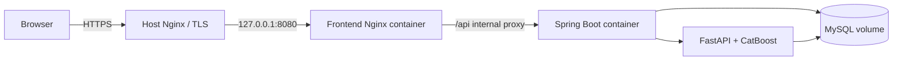

# Kiến trúc deployment

Production dùng [docker-compose.production.yml](../deploy/docker-compose.production.yml). Chỉ frontend bind loopback host. Host Nginx là điểm public duy nhất và kết thúc TLS. MySQL, Spring và FastAPI ở Docker internal network; Spring được frontend proxy nội bộ nên không cần publish riêng.

Ba image ứng dụng được build riêng: backend Java 21 runtime, frontend static Nginx, ML Python runtime nạp artifact hiện tại. Database là image MySQL 8.4 và named volume. Tất cả service có healthcheck, `depends_on` theo health và `restart: unless-stopped`.

Spring tiếp tục sở hữu auth, eligibility, workload, queue, fallback, ETA, assignment và persistence. FastAPI chỉ dựng feature và inference; nó không auto-assign và không quyết định ETA cuối.

Artifact checksum được khóa trong báo cáo live. Production Compose không mount source, không init lại schema và dùng `ddl-auto=validate`; schema/migration phải được áp dụng có kiểm soát trước deployment.
